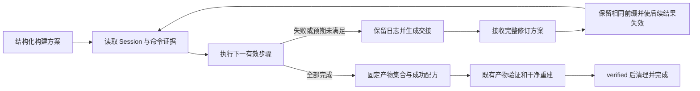

# 初始构建方案与状态执行最小原型

日期：2026-10-19。Issue：[ #468](https://github.com/WWFXL/Forge-AutoCompiler/issues/468)。工作类型：基础设施与工程验证。

## 本阶段回答的问题

初始方案能否交给 Workflow 执行，在失败时输出证据、接收修订、使旧步骤结果失效，并把最终成功路径交给既有验收？

本阶段已跑通这条链路。正常方案和恢复方案均由开发者准备，没有调用 Planner、恢复 Agent 或学习型选择器。它解除后续真实模型试运行的执行与审计障碍，不提供方法效果或创新性结论。前序观察见 [三项目走读](2026-10-19-build-plan-walkthrough.md)。

## 已实现的流程

实现入口为 `backend/packages/harness/deerflow/compile/plan_workflow.py`，独立 CLI 为 `scripts/forge_build_plan_prototype.py`。它们是显式启用的原型；产品默认编译入口仍使用已有 Agent 流程。



当前状态来自权威 Session、命令完整记录、退出码、超时和指定输出标记；不根据错误日志自动推断缺哪个依赖。宏观阶段绑定初始方案中的具体命令，失败时暂停并交接。当前选择器只是确定性规则。

| 状态或条件 | 当前动作 |
| --- | --- |
| 前序步骤有效、预算充足 | 执行方案中的下一步 |
| 非零退出、超时、缺失必需输出或前提 | 保留失败证据，进入 `needs_handoff` |
| 有匹配交接和合法修订 | 更新方案，重新执行受影响步骤 |
| 所有步骤通过 | `ready_for_verification`，尚未宣告成功 |
| 产物集合不符或系统验收未通过 | 返回交接；终态 Session 不允许继续 |
| 命令、交接次数或执行时间预算不足 | `budget_exhausted` |
| 权威 Session 已 verified 且 clean replay passed | Workflow 记为 `verified`；清理成功后 Session 才 completed |

交接方返回**完整方案建议及理由**，Workflow 负责执行。当前接口不允许接管方直接在 Session 中执行命令；外部命令记录变化会使旧交接失效。未来工具型恢复 Agent 若要直接执行，需要另行设计受控移交协议。

## 输入与修订契约

`BuildPlan` 绑定方案 ID、递增版本、仓库 URL、完整 commit、不可变 image ID、可选源码归档 SHA-256、构建系统、固定产物路径和有序步骤。支持 CMake、Make、Autotools 的方案表达；本阶段真实仓库执行只覆盖 CMake，另有 Make 受控夹具，没有验证全部系统上的泛化。

`PlanStep` 的关键字段：

- `step_id`、`role`、`command`、`workdir`：步骤身份、宏观阶段及执行内容。阶段为 dependency/configure/build/smoke/artifact_stage，按前提顺序推进。
- `source`、`expected`：记录命令来源和文字预期，供追溯与解释；文字预期本身不是可执行验证器。
- `requires`：必须已经成功的前序步骤。
- `required_output`：退出码为 0 之外必须出现的输出片段；smoke 必须指定，避免“未发现测试但退出 0”被当作完成测试。它仍依赖任务作者制定可信验证要求。
- `diagnostic_paths`：相对当前工作目录的内部日志路径。在步骤执行后、容器清理前采集，记录缺失/失败，单文件上限 16 MiB。命令完整输出另存。

方案必须含 build、smoke、artifact_stage。执行目录限制在 `/workspace/repo` 或 `/artifacts` 内；拒绝关闭 strict shell 或混合多个已识别逻辑阶段。该校验不等于通用 Shell 安全证明，方案必须来自可信调用方。

修订必须匹配活动 handoff ID、版本恰好加一、理由非空，不能改变源码/镜像/构建系统/固定交付要求，也不能替换或降低既定 smoke。仅修改来源文字的方案不触发重复执行。

修订只保留执行签名相同的前缀；从第一项执行变化起，后续成功 receipt 均失效。**失效的是成功记录，不会自动回滚工作区。** 安装依赖后清理 CMake cache 等必要操作必须写入修订方案，最终 clean replay 检验是否遗漏生成步骤或依赖脏工作区。失败和被替代命令保留审计，但不进入最终成功配方；smoke 单独进入 verification recipe。

## 运行方法

先准备根目录即仓库根的源码 tar、与该归档 SHA-256 绑定的方案 JSON，并确保本机已有方案声明的镜像。CLI 不调用模型，也不下载源码；输入方须提供可核验的源码来源。归档哈希可验证内容绑定，CLI 本身不独立证明任意归档与所声明远端 commit 的对应关系。

从仓库根进入 `backend/` 后：

```bash
uv run --no-sync python ../scripts/forge_build_plan_prototype.py \
  --plan /absolute/path/plan.json \
  --source-archive /absolute/path/source.tar \
  --output-root /absolute/path/new-run \
  --verify
```

可加 `--repair-plan /absolute/path/revision-2.json`，在首次交接后提供一次预先准备的脚本化回复。输出目录必须不存在。完整可用的 cJSON 输入保存在本报告下方证据目录的 `normal-plan.json`、`failed-target-plan.json` 和 `repair-plan.json`；重新执行应使用新的输出目录。

进程内接入方式：

```python
from deerflow.compile.plan_workflow import BuildPlan, PlanWorkflow

plan = BuildPlan.model_validate_json(plan_path.read_text())
workflow = PlanWorkflow(plan=plan, session=session, manager=manager, runtime=runtime)
state = workflow.run()
if state["status"] == "needs_handoff":
    workflow.apply_revision(
        handoff_id=state["handoff"]["handoff_id"],
        plan=revised_plan,
        reason="说明依赖或构建命令的具体变化",
    )
    state = workflow.run()
if state["status"] == "ready_for_verification":
    state = workflow.verify()
```

上述变量由调用方提供。Session 必须已准备好源码和容器，身份与方案一致，且由该 Workflow 独占；`verify()` 要求既有 CompileOperationsServices 使用同一 manager/runtime。CLI 展示完整准备与清理路径，临时服务绑定仅适合独立进程使用，不适合作为多任务并发服务入口。

支持同进程暂停/返回；`build-plan/state.json`、版本方案和交接文件用于审计，**尚不支持进程重启恢复**。默认方案预算为 32 条命令、2 次交接、600 秒、单命令最多 120 秒；等待回复也占用方案墙钟。诊断采集另有 10 秒控制时限；CLI clean replay 上限 180 秒，清理使用既有独立时限。这不是完整统一的动态预算控制器。

## 工程验证结果

| 验证 | 观察 |
| --- | --- |
| 相关单元与回归 | 185 passed，覆盖方案、交接、修订失效、预算、既有编译运行时与 Harness 边界 |
| 最终代码真实 Docker 夹具 | 1 passed；Make 编译静态库，测试故意失败，脚本增加生成步骤后恢复；验收、clean replay、cleanup 均通过 |
| cJSON 正常方案 | 19 项 CTest 通过；指定共享库结构验证及 clean replay 通过，Session completed |
| cJSON 脚本化恢复 | 故意使用不存在的 target，失败交接；修订默认 target 后成功，Session completed |
| 失败证据保留 | Docker 夹具的 `tests/test-suite.log` 在清理后仍可读取；失败测试 receipt 没有进入成功验证配方 |
| 静态检查 | 四个新增 Python 文件 Ruff check/format 和 Git diff check 通过 |

cJSON commit 为 `c859b25da02955fef659d658b8f324b5cde87be3`，镜像为 `sha256:d27a6ab733c7c3a9cbb5e4b32fb595aa5a422ff04bd212888d1041b90a2c4c2a`，2 CPU。交付合同仅为 `libcjson.so.1.7.19`，不代表完整安装包。两次构建和 replay 的库大小均为 50,256 bytes，SHA-256 均为 `66aea1ae75dd1b7bc196f435f98a4b2b8eabaf1bd6c8bc1282bd4ca13c61286f`。

这里调用了既有 submit/clean replay，不是正式 S0–S5 独立 oracle/provenance 比较。不存在真实 Agent 修复成功率、自然失败成功率或跨系统效应估计。受控 Make 失败和 cJSON 错误 target 都是人为工程测试，不能混入自然失败样本。

## 证据与版本边界

开发验证输出：`/home/yiwei/.codex/outputs/forge-build-plan-prototype-2026-10-19/`。

- `scope.json`：开始验证时的范围与当时代码哈希，保持原样。
- `normal/result.json`、`repair/result.json`：两条 cJSON 路径；各自 `.compile-sessions/build-plan-prototype/<session_id>/` 保存权威 Session、命令日志、版本方案与 replay。
- `docker-test-release/test_failed_test_log_survives_0/run/`：最终控制代码的真实 Docker 回归，含失败内部日志。较早的 `docker-test/`、`docker-test-final/` 保留为开发历史。
- `final-code/`、`final-validation.json`、`verify-development-evidence.py`：最终源码副本与哈希、只读核验结果及核验脚本。

两条 cJSON case 在最后的日志/服务一致性等修订之前运行，初始 `scope.json` 保留其版本边界；最终代码另经 185 项回归和 Docker 夹具验证，不把早期结果冒充最终代码重跑结果。本分支基于 `6a49ee26`，不是另一个工作树中的最新历史实验 release，后续集成前仍需核对版本。

前序走读证据没有补填或重跑。其封存 inventory canonical SHA-256 仍为 `ba351e5c7735263b3181395b4e18a42dcb91adcaeae2967760b09a2176c2b5a5`；libusb 历史失败的内部日志缺口和未知根因仍然保留。本轮只证明新执行路径具备日志采集能力。

## 下一阶段决策

建议先接入真实初始方案生成与恢复回复，做小规模端到端试运行，观察方案错误、交接原因和修订后重建是否闭合，再决定哪些状态值得引入比规则更复杂的动作选择。Provider、模型、样本、调用/费用上限和停止规则需在运行前明确；本轮未读取凭据、调用 Provider 或创建正式效果实验。

后续可检验两个相互衔接的问题：状态与方案失效建模能否减少无效执行；验证反馈和恢复机制能否提高可复现交付率。它们目前是待检验的研究问题，不能凭本轮工程完成认定为两个已成立的创新点。
