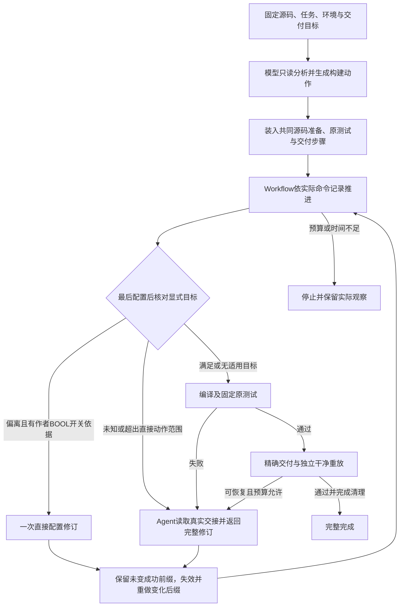

# 当前状态感知构建方法：实现、动作与论文证据

核对日期：2026-10-29；代码基线 `e0b7eac682807facc890488cc10de55ae4767f79`；[Issue #646](https://github.com/WWFXL/Forge-AutoCompiler/issues/646)。本次是方法梳理与已有结果分析，没有新增模型效果实验。以下只描述当前比较实际使用的实现。

## 方法解决的问题

项目的构建方案既有可重复执行的阶段结构，也可能偏离实际环境或任务目标。方法先由模型分析源码并生成构建动作，再由Workflow持有执行记录和任务约束：正常时推进，显式配置偏离且有充分依据时直接修订，其他失败交由Agent分析；修订后从首个变化处重做后缀，最终独立验证完整任务。

这是一种自动化编译领域的方法与系统贡献。贡献重点是把任务目标、执行状态、受限动作和重新验证连接起来；当前不能称为学习型状态识别器、一般依赖求解算法或新的通用Agent机制。

流程图概括运行逻辑，不表示任意失败均可恢复。配置直接动作每任务最多一次；原有恢复、时间和费用上界仍约束执行。

## 状态如何产生、动作如何选择

宏观阶段是依赖、配置、编译、测试、交付和重放；阶段本身不等于方法的语义状态。实现还记录方案版本、已完成步骤及其命令ID、权威命令记录、当前配置观测和剩余预算。下面的表是论文解释层，具体运行字段仍以代码为准。

|阶段／状态|实际观测依据|当前动作|实现边界|
|---|---|---|---|
|初始方案尚未形成|固定任务、源码文件和只读工具返回|模型生成dependency/configure/build动作；系统装入固定测试与交付|不把人工参考命令提供给模型|
|当前步骤具备执行条件|依赖步骤已完成，成功记录与当前方案一致|直接执行方案中已生成的指令|指令来自本项目方案，非每个项目固定模板|
|步骤成功|真实exit code为0、未超时、必要输出标记齐全|记为成功并推进|日志标记只作任务所声明的检查，不代替后续验证|
|配置满足显式目标|刚生成的CMakeCache原字节与固定任务BOOL要求一致|继续编译，无模型调用|只支持当前解析器可识别的显式CMake要求|
|配置偏离且可直接修订|缓存变量为BOOL、属于作者声明的option、来源目录正确，尚未用过直接修订|插入一次`cmake -S … -B … -D开关:BOOL=ON/OFF`，重新观测并执行后缀|不改HAVE_*探测值，不猜包名、路径或版本|
|配置未知／偏离但无法直接修订|缓存缺失、变量不可确定、无作者开关依据等|交Agent，保留未知状态及真实证据|未知不当作满足，不自动拼接安装命令|
|步骤失败或预期不满足|真实非零退出、超时或必要输出缺失，连同日志|交Agent返回完整修订与理由|缺依赖、链接错误和产物预期路径错误均主要在此处理；当前无统一语义分类器|
|修订使旧状态失效|新旧方案逐步比较，定位首个变化位置|保留之前相同且成功的前缀，重做变化后的步骤|逻辑失效不会自动删除磁盘旧产物；依赖／配置变化需要修订方案显式清理|
|方案执行完毕|固定测试及精确暂存步骤通过|提交独立验证、完整同镜像clean replay|工作区构建成功尚不是完整完成|
|预算不足／证据已过期|实际用量与截止、交接身份或命令记录不匹配|停止或拒绝旧修订，保留观察|不通过重试、回填或改验收变成成功|

状态检查由工具读取和代码计算；**直接动作的选择条件由代码约束，具体初始方案与超范围恢复由模型生成**。当前配置增强不是对全部C/C++错误的覆盖。Make/Autotools仍使用阶段记录驱动的普通Workflow＋失败Agent，不冒称具有同样的CMake配置语义。

## 对照一个已有自然案例

snappy任务要求原测试及benchmark保持开启。E01某份自然初始方案配置了`SNAPPY_BUILD_BENCHMARKS=OFF`：

1. configure退出0，但实际缓存与固定任务的ON要求不同，因此“命令成功”与“目标满足”是两个状态。
2. 观察器读取原缓存并保存其内容哈希；作者CMake文件确有该BOOL选项，允许一次直接修订。
3. Workflow插入原构建目录上的开关修订，重新观察为满足后编译，原测试、精确交付和clean replay均通过。
4. 这个恢复不需要新模型请求；若是找不到某个依赖或开关没有可靠声明，则交Agent。

该案例来自已见方案的组件实验，不用于估计未知项目上的自然偏离率。E30独立规划的48次系统比较中，14次配置观测全部满足、直接动作0次，不能把其系统费用收益全部归为此动作。

## 论文证据怎样连起来

|研究问题|已有主要证据|可写结论与下一缺口|
|---|---|---|
|完整方法有没有价值？|[E30：48次系统比较](THESIS_EVIDENCE_INDEX.md#e30)|本批Forge与强工具均16/16完整，估费低22.9%、请求少42.1%、累计时间低2.7%；缺口是未用于当前方法调试的新项目|
|提前观察与直接动作各有什么作用？|[E01：同初始方案30次消融](THESIS_EVIDENCE_INDEX.md#e01)、[E02](THESIS_EVIDENCE_INDEX.md#e02)|配置偏离可提前发现；四次直接修订完整完成且无恢复请求；单独提前Agent存在成本取舍；下一步扩展新方案，保留满足层|
|异常恢复是否必要？|[E04：恢复开关](THESIS_EVIDENCE_INDEX.md#e04)|相同初始方案下，允许恢复可增加本组完整完成；不能把轨迹中的恢复次数当作独立因果实验|
|为何要分层验证？|[E16–E19](THESIS_EVIDENCE_INDEX.md#e16)及各批分层结果|构建、原测试、交付和重放有不同失败与未观察；不把某一裁判更严格造成的拒绝直接称作功能错误|

下一比较保持当前实现；产物路径语义、依赖状态分类、学习型选择器和递归Harness均是候选改进，不写成已经实现或已获增益。新项目系统比较先回答迁移后的完整方法表现，随后复用其全部自然初始方案准备同方案组件消融，不按可修复性挑选正向案例。

## 对应代码

- [goal_state.py](../../backend/packages/harness/deerflow/compile/goal_state.py)：显式目标提取、缓存观测、直接修订、GoalStateWorkflow和Agent回退。
- [plan_workflow.py](../../backend/packages/harness/deerflow/compile/plan_workflow.py)：权威命令记录、阶段执行、交接及首变化后缀失效。
- [source_preparation.py](../../backend/packages/harness/deerflow/compile/source_preparation.py)：原源码共同索引准备与PreparedWorkflow。
- [unified_plan_equivalent.py](../../backend/packages/harness/deerflow/compile/unified_plan_equivalent.py)：构建动作与系统固定测试／交付的装配边界。
- [系统比较入口](../../scripts/forge_build_system_comparison.py)：E30实际调用的三系统适配，代码与原冻结结果保持不变。
