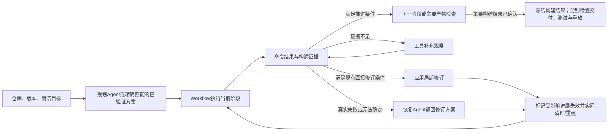

# 简洁构建任务与状态判断设计

Issue [#671](https://github.com/WWFXL/Forge-AutoCompiler/issues/671)，2026-11-04。状态：**方法设计完成，待最小实现与试运行；不是已运行协议或效果报告**。依据上午讨论及[E40/E41结果](2026-11-04-two-level-experience-results.md)，保持“面向C/C++仓库自动化构建的状态感知动作选择与验证方法研究”主线。

本阶段交付任务定义、阶段决策、结果口径和实施顺序，新增模型调用与实验数据均为0。旧实验、论文v0.6及其完整验收保持。本设计给出新任务的建议评价口径，正式比较前须将样本、判定、预算和时窗一并固定；不把新任务结果与旧完整任务直接作加速比较。

## 1. 任务与适用范围

统一输入：

> 在给定Linux环境中，依据仓库作者推荐或默认方式，从指定版本源码构建该项目的主要程序或库。保持原源码和测试；正常生成配置文件、辅助脚本及构建产物遵守已有生成文件边界。

所有方法获得相同仓库/commit、源码内容、环境与资源说明、上述目标以及必要的共同澄清。初始输入不提供人工成功命令、参考产物路径、逐项目验证脚本或复杂配置清单。规划Agent负责读取文档和构建文件，识别主项目、构建入口、依赖和阶段命令；不另设意图识别Agent。

装配时显式分开传给模型的公开任务和仅供共同检查使用的参考数据，不能把包含参考脚本/路径的整个评测任务对象直接序列化进提示词。参考组件的身份不由某一方法生成或改写。

选择优先级为：该commit适用的作者Linux普通构建说明 → 作者给出的本地构建脚本/预设 → 顶层构建系统默认主目标。CI用于补充依赖和平台证据，不机械复制发布、打包、交叉编译或覆盖率任务。文档推荐与工具默认不同时，采用适用的作者推荐方式并记录依据。

不人为强制Debug、静态库、全部示例、benchmark或单独执行完整测试；默认构建自然包含的组件照常构建。禁止为了避开真实主目标失败而关闭主程序/主库、改源码或删除测试。可选测试/示例组件仅在文档明确其非主要组成时允许省略，记录理由并由共同检查确认没有遗漏主要产物。

首个实现范围为现有Linux ELF/`ar`、CMake/Make/Autotools仓库。纯header-only、内核、交叉目标、多主项目且文档无法确定范围的仓库，在正式选样前登记为不在本轮范围或目标待澄清；不临时制造一个小程序来代替原项目，不在看到方法结果后删项目。此范围限制须随论文结果披露。

## 2. 谁确定“构建什么”，谁定位“产物在哪”

运行系统与比较评测分开承担职责：

| 层 | 内容与责任 | 不承担的责任 |
|---|---|---|
| 共同任务输入 | 简洁自然语言目标、源码版本、环境和必要的共同澄清 | 不给人工成功方案或逐项目配置组合 |
| 规划Agent | 从仓库证据提出主要组件、选择入口、形成阶段命令；产物位置是候选 | 不自行缩小主要组件或制定最终成功标准 |
| 构建观察工具 | 读取实际执行记录、构建目录及元数据，定位真实产物 | 不把模型猜测的目录/日志当独立事实 |
| 比较用参考表 | 运行前根据该commit文档/构建文件，人工核对少量主要组件；必要时参考构建佐证可构建性 | 参考命令及路径不注入方法上下文；不由各方法各定一份标准 |
| 共同结果检查 | 检查主要组件覆盖、产物结构、源码保持和当前构建关联 | 不以任一ELF文件存在就判仓库构建完成 |

参考表只保存声明式数据：仓库版本、主要逻辑组件、允许的产物类别/规范名称或版本化别名、依据文件与位置。每个主要组件必须覆盖；共享/静态库仅在文档未要求特定形式时作为同一组件的允许实现。明确列出排除的辅助工具/示例及依据，不允许通过宽泛文件名模式把任意测试程序当主程序。必要的人工核对工作量单独报告，不声称任意新仓库已经零人工评测。

多个同等主目标无法确定时，正式采集前向所有方法公开同一句简短澄清，或保留为范围未定；不得只给Forge提示。精确路径留在评测侧作定位线索，不作为必须相同的输出目录。初次结果检查若反馈缺少哪个逻辑组件，所有方法可获得同类反馈并在相同预算内恢复，参考配方仍不公开。

CMake可用File API codemodel的target/artifacts映射确认产物；仅声明查询文件而不改变构建选项。没有该元数据时，复用实际构建记录和安全目录扫描，对照参考组件定位并检查ELF/`ar`。Make/Autotools没有普遍可用的完整目标数据库，不伪装成已自动理解其全部语义；保留独立参考表、真实路径及文件身份的核对。正式运行从干净源码开始，排除归档自带的预编译文件和系统依赖，防止旧产物冒充本次结果。

## 3. Workflow与状态的最小设计

沿用“初始规划→阶段执行→观察→有条件修订/Agent恢复→重执行受影响部分”。首版继续采用已有方案式恢复：Agent读取证据并返回修订方案，Workflow实际执行。工具局部恢复已有独立实验，本轮不同时更换恢复范式；后续比较可另行评价。

图中的补充观察受命令/时间预算约束；相同证据与相同动作不得无限循环。资源不足时明确终结并保留部分结果。

状态只保留决策所需的信息：`phase`、命令ID/退出码/超时、实际构建目录与元数据证据、主要组件覆盖（满足/不满足/未知）、方案版本与有效前缀、剩余执行资源。阶段是位置，状态是该位置的事实。数据缺失保持未知，不靠新增置信度分数掩盖。

| 阶段 | 最低观察与推进条件 | 异常时的动作 |
|---|---|---|
| 依赖准备（可无） | 实际安装/准备命令成功；不强求预先证明全部传递依赖齐备 | 非零保留真实日志；由Agent处理不明确依赖。配置后暴露新依赖则返回依赖阶段 |
| 配置（Make可无） | 实际命令成功。CMake核对所用构建目录的Cache、源码目录和实际generator对应的构建入口；Autotools仅对确实运行configure的路径观察其生成状态 | 缺证据先读实际目录。明确前提不满足才修订，不能固定要求`build/build.ninja`；不运行configure的项目标为不适用 |
| 编译 | 当前有效配置下真实编译命令成功；记录命令和产物观察，不额外要求模型猜测的成功日志片段 | 非零进入恢复；命令成功但主产物尚不清楚，进入定位/主要产物检查，不把它直接改称编译器失败 |
| 主要产物检查 | 主组件被实际产物覆盖，文件非空且结构/平台正确，与当前源码构建关联，源码保持，无未完成的进展失效 | 路径定位问题先观察；确实遗漏主目标则Agent修订构建；证据不足记录未知，不直接通过 |

配置观察只验证当前任务确实要求的条件。未要求Debug/静态库时，不沿用旧脚本凭空增加BOOL目标；已有CMake配置修订仅在明确目标、真实观测与作者声明开关均满足原适用条件时使用。此时规则可能不触发，应如实报告，不为凸显状态感知制造错误或扩大规则。

规划响应保留动作、目录、前提和证据来源；`expected`仍可作说明。新主任务中，模型提供的`stdout_contains`、`files_exist`、`directories_exist`不作为任意新增的否决条件；可靠的必要事实由构建系统观察器和共同结果检查产生。必要依赖探测可以是显式命令，仍以实际退出码记录。需要处理“编译未成功却被脚本吞错”的情况，因此保留严格Shell与独立产物检查，不能简化成只看退出码。

提示与响应约定同时避免在构建命令内嵌无依据的路径/日志断言；接口分离只能减少此类错误，不能保证模型永不生成错误Shell。实际内嵌断言、语法错误或错误目标仍保留为失败与恢复成本，不能预先宣称已消除全部规划错误。

## 4. 恢复与有效进展

| 已观察状态 | 选择动作 | 重执行边界 |
|---|---|---|
| 配置已完成，实际generator为Unix Makefiles；Ninja文件不存在 | 使用实际generator的构建入口，删除无依据的附加断言 | 原配置仍有效时保留；只定位路径不应导致重新编译 |
| 已编译，模型猜测路径错误，真实主库在另一目录 | 工具定位主组件并交共同检查 | 保留编译结果；不得用`touch`假造文件，也不必为改路径重做配置 |
| 确认缺少依赖，但无法从现有依据确定安装动作 | Agent修订依赖/配置动作 | 新依赖可能改变探测结果，按已有规则实际清理缓存并重新配置、构建 |
| 配置目标确实不满足，且现有有限修订有合法依据 | 直接修订；不满足条件则Agent | 从配置起重做，并实际处理旧产物，不仅删除逻辑完成标记 |
| 需要`make clean`后重新构建 | 将清理视作当前阶段的前置操作，检查其作用范围 | 只允许清理生成物；严格Shell、源码/测试保持、预算及操作边界继续适用 |
| 超时/资源不足或重复建议没有新依据 | 停止或在已有预算内选择不同合法动作 | 保留部分观察，禁止自动重试旧身份或改判未观察层 |

首版继续复用已有“首变化步骤之后重做后缀”的保守算法，不实现新的增量依赖求解器。要单独处理的是：纯产物定位属于结果检查，不应改变前面的构建动作；实际命令、依赖或配置改变则按现有算法失效。逻辑失效与物理清理分别记录，防止出现libverto中配置已变但旧产物未重建的情形。

清理兼容改动须针对已观察的正常阶段内组合，不能把任意`rm -rf`、混合源码改写或失败屏蔽放行。不关闭全部角色保护，也不按具体仓库名打补丁。当前源码对`make clean`/`make`组合仍有限制，本节是待实现行为。

## 5. 新任务的结果与计时建议

采用两个独立回答：“主要构建是否成功”和“结果是否经过进一步验证并可重建”。建议主比较以**主要构建任务完成**为主要结果，同时强制报告下面各层；新名称与旧`full_completed`区分，不能只换名字沿用旧成功率。

| 结果字段（概念名） | 意义与判定 |
|---|---|
| `command_build_passed` | 有当前有效配置下成功的真实编译命令；不等于主任务完成 |
| `primary_build_completed` | 真实编译成功＋参考主要组件覆盖＋有效产物/平台/来源检查＋源码保持；资源或目标证据未知时不能为true |
| `delivery` | 精确暂存实际主要产物；复用已有交付检查，不任意整目录复制 |
| `author_tests` | 使用比较前确定的作者原测试及统一资源上限；分别记通过、失败、超时、未观察或确实不适用。零测试不是通过 |
| `clean_replay` | 复用现有同镜像、干净源码、配方与精确交付检查；保留产物哈希差异及失败，不改旧裁判 |
| `full_completed` | 只在明确列出的全部要求都满足时报告；旧实验此字段完全保持原定义 |

主要构建结果确认后冻结该层记录，再作交付、作者测试与干净重放。测试失败/超时保留为测试层结果，不能宣称软件功能正确；也不能抹去已观察编译。单独执行作者测试不占用主构建恢复预算，以免测试拖到超时后使重放永远未观察；默认编译本身包含的测试目标仍属于原构建过程。

运行前冻结共同测试命令/范围与独立时限，作者测试不要求方法再生成一套复杂目标。首版优先复用原有测试入口，作为评测侧材料，不注入规划提示；若不同配置无法运行相同测试，标明不适用/未观察及原因，不临时换成容易的测试。测试对工作区有副作用时，不将其生成物混入构建配方或交付，干净重放仍从固定源码重建。

分别计量初始规划、依赖/配置/编译、构建恢复与结果定位、交付、作者测试、重放及总耗时；模型的读取、失败、结构纠错和恢复请求全部计费。主构建时间截至共同主要产物检查首次通过，之后的总流程时间另报；失败/超时同样保留，不用早停制造效率优势。`primary_build_completed`不改变产品Session现有`verified/completed`语义。

这是新任务的建议终点拆分，不是旧实验验收放宽或旧失败重标。正式采集前将上述要求与是否必须满足测试/replay才能称“完整完成”写入同一协议；不得只公布有利的主构建数而隐藏后续结果。

## 6. 三类项目的流程示例

以下为设计走查，不是新增运行或效果证据。具体依赖、命令和路径须依据选定commit与环境。

- **jsoncpp/CMake**：读取README与CMake文件，识别jsoncpp主库；配置`cmake -S . -B build`，观察实际Cache和generator；执行`cmake --build build -j2`。产物通过元数据/目录定位，例如真实库在`build/lib/`时，不因猜测的`build/src/lib_json/`缺文件而重编译。独立检查确认主库，随后分别记录测试、交付和重放。作者默认带入的测试编译不擅自移除；不额外强加Debug或库类型。
- **pigz/Make**：读取作者说明和Makefile，主目标为pigz程序；无独立configure阶段，执行正常make。若缺zlib开发依赖，真实错误交Agent修订依赖准备；装好后Workflow执行适用的重建步骤。成功后检查实际pigz ELF，不能拿系统已有pigz顶替本次产物。
- **libsigcplusplus/Autotools**：依据选定源码版本判断是否需要bootstrap，再配置并构建主库。缺`mm-common-prepare`时属于依赖/生成准备状态；Agent可修订准备步骤，Workflow在生成文件边界内重做。正常清理后构建不应只因housekeeping/build共存而拒绝，但原源码及测试保持仍必须通过。版本化主库名称由参考依据确定，不硬编码所有仓库共用路径。

## 7. 最小改造与后续比较

| 顺序 | 复用位置 | 仅做的改动/交付 |
|---|---|---|
| 1 | `unified_plan_equivalent_observed.py`及任务装配入口 | 新任务数据与规划输入；将模型附加断言与必要观察分离，旧冻结入口不改写 |
| 2 | `plan_workflow.py`、`goal_state.py`及既有运行记录 | 按构建系统补最小状态观察；复用修订与有效前缀；无明确配置目标不凭空加约束 |
| 3 | `operations.py`的角色判断、已有源码/生成物保护 | 正常清理重建的作用域识别；只修可复现缺陷并补针对性测试 |
| 4 | `plan_delivery.py`、现有产物检查/暂存/重放 | 参考逻辑组件与实际产物定位；分层结果与独立计时，不重写整个运行时 |
| 5 | 现有批执行、计费与分析入口 | 少量三系统端到端实跑后固定新比较；不重复历史资格链或无关产品全测 |

现有`BuildPlan`强制包含固定smoke和artifact_stage，现有ProjectRecipe又精确匹配artifact_paths/verification_steps，因此不能仅清空旧字段就当本设计已实现。新入口应显式区分任务版本和参考目标、构建动作与评测步骤，调整当前活跃装配/结果接口；旧runner、协议和冻结代码快照保持。原完整成功方案可作为有出处的候选，未核对新任务条件不能称新任务精确命中；经验登记需保留实际通过的验证层级。

第一轮系统比较建议先固定相同经验条件（两组均不注入经验），使用deepseek-flash、同环境/资源与共同结果检查，比较Forge与强工具Agent。两者共享可访问源码和执行能力，区别是阶段方案及Workflow控制与工具Agent逐步控制；不声称所有调用方式完全相同。CXXCrafter保留原方法能力，在共同任务和外部结果检查下作系统参照；如需适配，应披露改动，不能据该比较把全部差异归因状态组件。之后才补同目标下的状态组件消融、同项目方案复用和跨项目经验比较。

正式新项目、重复数、费用、时间、测试/replay数值上限与授权仍未冻结。最小实现只先验证正常构建、错误断言不再否决真实结果、真实失败修订、清理重建和源码保护这些受影响行为；工程观察不计正式效果。论文继续使用既有[证据索引](THESIS_EVIDENCE_INDEX.md)，本设计不新增实验编号或效果分母。

## 8. 文献与实现依据

- [CXXCrafter](https://doi.org/10.1145/3729386)，所读arXiv:2505.21069v1，§4.2–4.4/PDF12–14页：探索主项目入口；默认/主要组件应符合文档；明确提出退出码正常但缺实际构建的non-error failure，使用LLM判别和反思。本设计借鉴其问题，结果判断采用独立参考组件和实际产物，并非认为已有论文只看退出码。
- [CompileAgent](https://arxiv.org/abs/2505.04254v1)，§4.2及§5.1/PDF6页：探索、执行、错误修复；100项目人工参考目标。论文未明确参考目标清单是否直接作为Agent输入，不能据此断言其输入方式。
- [BuildBench](https://arxiv.org/abs/2509.25248v2)，PDF3、附录C.2/PDF16及C.3/PDF17页：有人标主要产物及Debug/安装等通用约束，生成器明确不运行make check/test。本设计不照搬Debug/安装要求，也不称完全复现其评测。
- 当前代码：[PlanWorkflow](../../backend/packages/harness/deerflow/compile/plan_workflow.py)、[观察式规划](../../backend/packages/harness/deerflow/compile/unified_plan_equivalent_observed.py)、[配置状态](../../backend/packages/harness/deerflow/compile/goal_state.py)、[两层经验](../../backend/packages/harness/deerflow/compile/project_experience.py)。结果基线版本`92d762e1e79b7835f73d79e8328f66e4c080debc`；代码已存在的行为与本设计待实现行为分别说明。
