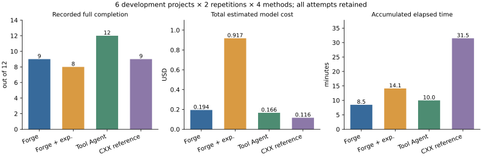

# 简洁构建目标下四方法系统比较

**48/48槽已终结，0未观察槽，38次记录完整完成。基础Forge/经验Forge/强工具Agent/CXX社区参考的主构建为9/12、8/12、12/12、12/12；记录完整为9/12、8/12、12/12、9/12。本批不支持新版Forge整体优于强工具Agent，也不支持当前经验注入减少探索。** CXX三次测试层未完成含入口适用性限制，不能直接据完整数排名功能正确性。

本轮为正式数据采集与结果分析，跟踪 [Issue #679](https://github.com/WWFXL/Forge-AutoCompiler/issues/679)，执行已合并 [PR #678](https://github.com/WWFXL/Forge-AutoCompiler/pull/678) 的固定版本。研究问题是：给定作者推荐或默认主要构建目标，模型规划＋状态观察/Workflow＋失败恢复，相比强工具Agent和CXXCrafter社区实现有何完成、费用和时间取舍；在Forge主体不变时，既有跨项目经验是否减少探索。

## 方法和共同任务

[协议](../../benchmarks/preregistrations/cpp-build-simple-system-comparison-flash-v1.md)与[manifest](../../benchmarks/manifests/cpp-build-simple-system-comparison-flash-v1.json)身份为 `cpp-build-simple-system-comparison-flash-v1`，SHA `e079b31a2f235ea24dc7a735a9704c7387addc3d69d8ab45fef1840b73337926`。运行release `0cd5314653437463c2088993dd973f9daf72bdf5`，173个冻结仓库运行组件不变。

|方法|实际执行方式|经验与工具边界|
|---|---|---|
|基础Forge|模型读源码并生成阶段动作，Workflow执行并观察实际状态，必要时模型返回修订方案|没有历史经验；沿当前已实现的方案恢复接口，不声称本批采用工具局部恢复|
|经验Forge|与基础Forge相同，规划/每个新恢复任务前选择一次跨项目经验并注入上下文|固定12轨迹/8来源族/24条库，top3来源/12000字节；任务内固定，无本项目精确方案、在线更新或新提炼|
|强工具Agent|Agent自主逐条选择命令，实际执行、查看反馈并提交成功recipe|复用共同运行记录、源码保护与外部验证；没有历史经验|
|CXXCrafter社区参考|保留Parser/Generator/Modifier/Judge，产生和修订Dockerfile并构建镜像|全部Judge/失败/修订计费；保留原生工具、镜像重建与内部预算差异，不冒充论文原版或纯状态因果对照|

CMake/jsoncpp和miniz、Make/pigz和highwayhash、Autotools/libite和libsrtp，每项目两重复×四方法，共48槽/每方法12槽。顺序采用四个Williams排列平衡位置和有向邻接。六项目均已有开发暴露、4C/2C++，不称holdout或大型C++总体；经验来源族与六评价族隔离，两重复不当两个独立项目。

公开任务只要求依作者推荐或默认方式构建主要程序或库，保持原源码/测试。私有主要组件参考、作者测试命令不送模型。作者原测试、精确交付、干净重放、源码保持和清理分层记录；主构建通过后测试失败不抹去主构建，未运行的层不填失败或通过。CMake独立测试从实际顶层Cache定位，串行且零测试报错，不能以不存在的固定Ninja文件否定实际配置成功。

全部请求统一deepseek-flash、thinking low/32768输出/无SDK自动重试。共同源码、基础镜像、网络和2CPU；初始规划、读取、输出、失败、恢复及原生Judge均计费。Forge与强工具保留180秒单命令/1200秒主Workflow内部预算，CXX原生Docker RUN/循环不同；共同总槽上限2700秒、最多96请求/100万recorded Token/1美元槽停止阈值。总计时包括准备/初始规划，主构建时间独立于后续验证；不能拆分的原生阶段不补造。

## 授权、运行及证据

用户原答复：“授权 10 美元、8 小时，按 48 次协议执行”。确认首次接收记录UTC2026-11-04 13:40:11，截止21:40:11（北京时间11月5日05:40:11），准备计入。共享新增10美元硬上限，无自动重试、不补槽；普通任务失败留存后继续，未知用量、模型身份异常、清理失败停止整批。唯一进程PID2501595，不因预算余额自动扩批。

raw：`/home/yiwei/.codex/outputs/forge-simple-system-comparison-flash-v1`。授权、启动、日志和后续发布收据：同级 `forge-simple-comparison-session-v1`。原始请求/响应、模型思考/工具调用、命令与日志、初始/修订方案、每层结果、交付与重放在逐槽目录保留。原件封存后只读；派生表在 `benchmarks/analyses/cpp-build-simple-system-comparison-flash-v1`。

## 全分母结果

48/48槽终结、0未启动/未闭合槽，`stop_reason=null`、计费完整。实际采集从UTC13:41:34起约3858秒（64.30分钟），未触达费用或时窗。各方法累计耗时之和约64.04分钟；两者差为批调度开销，不以相加时间冒充精确批墙钟。

|方法（各12槽）|主构建完成|记录完整完成|模型请求|全部在线估费/美元|累计耗时/分钟|
|---|---:|---:|---:|---:|---:|
|基础Forge|9|9|58|0.1942293|8.47|
|经验Forge|8|8|192|0.9172332|14.11|
|强工具Agent|12|12|64|0.1660431|9.99|
|CXX社区参考|12|9|78|0.1161618|31.47|

基础Forge/经验Forge分别有3/4槽在规划返回前停止，构建、作者测试、交付、重放和源码终态检查未观察；不是3/4次实际编译或测试失败。强工具12层均通过。CXX主构建/交付/构建重放12过，原测试记录9过/3失败；三条失败日志如下节，不当三次测试用例实际失败。全部48清理通过；源码终态检查41过、7未观察，无观察到的原输入改写失败。

|项目（每方法两重复）|基础Forge完整|经验Forge完整|强工具完整|CXX记录完整（主构建）|
|---|---:|---:|---:|---:|
|jsoncpp|1|1|2|1（2）|
|miniz|1|2|2|2（2）|
|pigz|2|2|2|2（2）|
|highwayhash|2|1|2|2（2）|
|libite|1|2|2|2（2）|
|libsrtp|2|0|2|0（2）|

图中的短耗时同时包含早停，不能脱离完成数解释为加速；CXX完整完成列受测试适用性限制。可复用的[PDF图](../../benchmarks/analyses/cpp-build-simple-system-comparison-flash-v1/system-comparison.pdf)、[逐槽CSV](../../benchmarks/analyses/cpp-build-simple-system-comparison-flash-v1/slots.csv)、[全表/阶段费用](../../benchmarks/analyses/cpp-build-simple-system-comparison-flash-v1/analysis.json)、[项目汇总](../../benchmarks/analyses/cpp-build-simple-system-comparison-flash-v1/by-project.json)和[配对结果](../../benchmarks/analyses/cpp-build-simple-system-comparison-flash-v1/paired.json)保留全分母。

### 条件性观察与全程判断

基础Forge比强工具少6请求，但总费用高约17.0%、少3次完整；全分母不支持Forge效率优势。两者共同完整的9对中，Forge/强工具为0.1045962/0.1160700美元，431.10/411.29秒：Forge费用低9.9%、耗时高4.8%。这是按完成条件筛选的辅助描述，不是对全任务成本或成功率的因果估计；不能据此掩盖格式失败费用0.0896331美元。

经验Forge比基础Forge少一次完整、请求192/58、初始源码读取363/64，在线估费约为4.72倍。两者均未发生恢复Agent请求，全部模型费用来自初始规划：不是失败恢复把初始节约抵消，而是方案产生前已出现大量探索和循环。每个经验槽仅一次检索，共12次，没有每轮刷新；同项目方案复用也未启用。该固定库/检索/上下文装配的本版组合未取得收益，不等于历史E37/E41或全部经验方法无效。

A/B有6对共同完整、2对经验组独有完整（miniz/libite第二重复）、3对基础组独有完整（highwayhash首重复和libsrtp两次）、1对共同未完整（jsoncpp第二重复）。保留经验组的局部有利观察，但同项目两重复不足以归因具体经验条目。旧库历史制库费0.095129美元另列，经验在线加一次库费为1.0123622美元；本轮没有再次支付制库费，没有把旧费算入新增预算。

CXX与强工具均12/12主构建，CXX在线费用低约30.0%，累计耗时约为3.15倍，体现模型费用与镜像执行的取舍。CXX相对Forge的完整数同为9/12，但错误来源不同；不能因完整数相同称方法等价，也不能以适配受限的完整数证明强工具功能正确性胜出。固定Flash只比较当前系统组合，不是模型排名。

## 未完成原因与证据

|槽|观察及实际停止位置|解释边界|
|---|---|---|
|16 highwayhash/经验；28 jsoncpp/基础；30 miniz/基础；44 libite/基础|前三槽的`ObservedBuildActions`参数为`{}`；44实际将完整步骤列表错放在`reason`且缺少`steps`。四次均抛`StructuredOutputValidationError`，在配置/构建前停止|2026-11-04逐槽核对校正了“全部为空”的原概括，原响应、结果和分母不变。已有部分合理命令，不能说模型完全不会规划；三个空参数缺独立HTTP流，不能唯一归因Provider或SDK|
|21/48 libsrtp经验、27 jsoncpp经验|每槽50次模型请求，反复list/read，达到LangGraph图递归上限100；没有执行编译命令|图轮次与单槽96请求上限是不同约束；并非费用用尽或缺依赖。没有扩大上限、重试或用后续方案回填|
|24/45 libsrtp CXX|原生先尝试Autotools后改用仓库自带CMake，主库/交付/重建通过；外部仍在源码根执行`make runtest`，日志`No rule to make target 'runtest'`|固定测试入口对构建系统切换不适用，不能称测试用例实际失败，不能回填为通过；本批原始`author_tests=failed`和完整否保留，主构建成功有效|
|26 jsoncpp CXX|Dockerfile显式`-DJSONCPP_WITH_TESTS=OFF`，外部实际测试目录观测为`[]`，主库/交付/构建重放通过|未构建/注册作者测试，不是用例运行后失败。私有测试要求不提前送模型，公共默认目标与原生生成策略仍可能有差异|

上述10个槽均清理成功。CXX的`clean_replay=passed`在作者测试未过时只支持构建/交付重放，不声称测试重放成功。无需修改裁判、放宽验收或丢弃失败即可解释各层结果；后续若修适配或Harness，应另建版本与身份。

### 两个具体规划案例

jsoncpp首重复的基础方案与经验方案最终都采用`cmake -S . -B build -DCMAKE_BUILD_TYPE=Release`再构建默认目标，且完整通过；但基础1次源码读取/2模型请求，经验35次读取/17请求。经验一次注入两个来源、10320字节；已保存的相同path/start_line/max_lines读取有25次重复。说明本例代价主要发生在方案输出前，不能以“最终方案合理”证明经验减少探索。

libsrtp经验两重复均初始选择一次E30-slot-1、5525字节，每次50请求；基础两次均5请求并完整。三次循环槽（两libsrtp加jsoncpp第二重复）共150请求、估费0.7359741美元，约占经验组80.2%费用。补充精确重复读取统计为经验组269次、基础12次，只描述同一Agent任务的重复调用，不证明每次读取均无用或单独归因经验文字。详见[读取模式](../../benchmarks/analyses/cpp-build-simple-system-comparison-flash-v1/read-patterns.json)，这是消费同一48槽的事后机制描述，不新增效果分母。经验扩展上下文、公共裁剪策略和模型行为如何交互仍需定向检查，不能仅凭重复轨迹认定唯一根因。

## 核对、成本与论文用途

全部392个完成响应逐一与槽账本核对请求数、输入/输出和费用一致：输入4,053,018、输出148,135、记录Token合计4,201,153，新增估费1.3936674美元，未知0、未闭合0。采用冻结费率输入0.30/输出1.20美元每百万Token，全输入按缓存未命中保守估费，不是实际账单。响应标识在已接受的Flash标识内；不采用CXX原生跨槽累积日志作单槽费用。

原件封存`ab698898a33343ad780e96fb4d963b349304c6494c64e3cebd20d3f914918a34`，119662普通文件/407链接/677641105字节，类型化只读校验通过。173运行组件未变；48槽清理记录通过，391个容器标识（名称/ID/原生中间容器，非391个独立容器）和26镜像ID只读实查均不存在。费用校验和主要指针见[响应核对](../../benchmarks/analyses/cpp-build-simple-system-comparison-flash-v1/response-verification.json)、[证据收据](../../benchmarks/analyses/cpp-build-simple-system-comparison-flash-v1/evidence.json)，授权/launch/final-resource-observation在会话目录。未再执行产品全测或旧资格；本轮工程检查不是额外模型效果。

本结果可写入第6章新版简洁任务的完整系统比较、跨项目经验消融、成本分解与失败案例，第4/5章可据实际接口说明边界。现有v0.6和E01/E30/E33/E35–E41继续按原身份使用；任务简化后的完成率与历史批次不可直接相减估计算法收益。本批没有有效方案后的Forge恢复调用或同初始方案状态消融，因此不证明状态选择的独立增益或局部工具恢复优劣。

下一步应先处理已定位的三个问题：结构化方案空参数时的显式纠错/反馈，重复源码读取与证据保留，跨构建系统的测试入口适用性。先用现有轨迹形成最小修复与有针对性的离线回归，再以独立小规模配对观察是否减少这些具体失败；不立即扩新组件、扩大请求上限或重跑整个48槽追求好结果。本轮预算余额不自动授权新付费身份。论文可先使用本批真实全表和限制；不以必须全面胜出作为继续论文的门槛。
