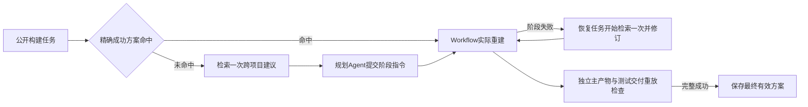

# 两层经验完整流程与三方法比较准备（2026-11-05）

用户要求先完成两层经验流程装配和修复后的完整系统比较。本记录是工程装配与实验准备，不能计为新模型效果；正式结果另用同名实验报告保存。

## 已完成装配

共享 `run_simple_system` 原已支持同时传入成功方案和经验建议库，继续复用该接口。新增 `select_simple_recipe` 按完整公开任务检索固定历史方案；仅运行标签不同可命中，其他字段不同则弃权，同身份多方案拒绝隐式选第一项。新批量入口自动完成：

每个恢复任务独立检索一次，任务内不刷新。完整成功的最终方案保存在本槽，正式比较使用固定库，不将本批输出读回后续重复。基础 Forge 和强工具 Agent 不接收经验；没有新提炼模型、语义检索器或产品 UI 改造。

## 样本与必要实跑

| 分层 | CMake | Autotools | Make |
| --- | --- | --- | --- |
| 精确方案复用 | jsoncpp | libite | highwayhash |
| 新增无方案 | double-conversion | libogg | xxhash |

三份复用方案来自 E45 第一重复 Flash 固定来源，不按本批结果挑选；新项目在正式方法结果前固定 commit、源码归档、主要组件和作者测试。全部先参考构建，不能称严格 holdout。

三个新增项目独立参考均通过主产物、作者测试、交付、clean replay 和 cleanup。double-conversion 升级到作者要求的 CMake，9 项 CTest 通过，主构建145.65秒/重放316.80秒，包含两次空环境的依赖下载；libogg 两个作者自测完整通过，xxhash 使用作者普通 `make check`（sanity及CLI检查），不扩为跨平台CI矩阵。参考命令不进入正式规划/工具 Agent 上下文。

联合入口另作两条零 Provider Docker 实跑：highwayhash 同时提供方案库与建议库，精确命中，初始模型及建议检索均0；libogg 未命中，实际 Agent 图接收一次离线结构化回复、检索一次建议后执行。两条均完整、源码保持且保存可复用方案。离线回复不是 Flash 效果或真实模型请求。

75项相关回归、Ruff及格式通过；不重复全量本地产品测试。准备过程中原生 Git clone 的 TLS 失败、double-conversion 首次下载超时及空归档、首份参考驱动的缺测试输出依据错误、首份离线驱动缺 `responses` 参数错误均保留；后两项发生在对应新运行开始前。double-conversion 已完成参考被只读复用，未重新执行或回填。

## 真实比较

身份 `cpp-build-two-level-system-comparison-flash-v1`，6项目×2重复×基础Forge/两层经验Forge/强工具Agent，共36次；每方法12次，每层每方法6次。六种顺序各两次、每项目第二重复反转顺序。共同 Flash low、相同公开目标/源码/镜像/并行资源/独立检查；强工具 Agent 保留自主动作接口，是系统比较，不称同 Harness 的纯状态消融。

分别报告全分母和两层分母，包含全部规划/读取/纠正/失败/恢复费用及分项时间；测试配置缺口与主构建失败分开。历史库提炼费和成功方案来源构建费另列。旧E46/E47、先前状态/恢复消融及论文v0.6原样保留。

本轮用户已明确要求执行这两项；助手自行将新增费用收紧为2美元、准备与运行合计最多4小时，无自动重试、不补槽，未知用量/模型身份异常/cleanup失败停止。正式运行前在独立授权记录中绑定当前请求、manifest SHA、具体截止和来源；不宣称用户逐项回复过新的数字，也不续用旧预算。

## 入口与证据

- [预注册](../../benchmarks/preregistrations/cpp-build-two-level-system-comparison-flash-v1.md)、[manifest](../../benchmarks/manifests/cpp-build-two-level-system-comparison-flash-v1.json)、[六任务](../../benchmarks/fixtures/two-level-system-comparison-v1/tasks.json)。manifest SHA `e0bc1bbaedb744a79097d02dd02206889c8821a0c60151449b208bbe00b47d2f`。
- `scripts/forge_two_level_system_comparison.py` 复用共同执行和计费，支持准备、检查、执行和只读分析；历史来源及源码组件随 manifest 固定。
- 准备原件：服务器 `/home/yiwei/.codex/outputs/forge-two-level-system-session-2026-11-05-v1/`；`references/`、`joint-engineering-v2/`、对应驱动/原始错误/日志和 `related-tests.log`。新增真实 Provider/Token/费用均0，仅支持执行实现。
- 发布只到科研集成分支 `yiwei/534-rq3-natural-failures`，Issue #691。原用户 checkout 的 memory、HTML、uv.lock 保持，后续付费运行使用此独立 worktree。
