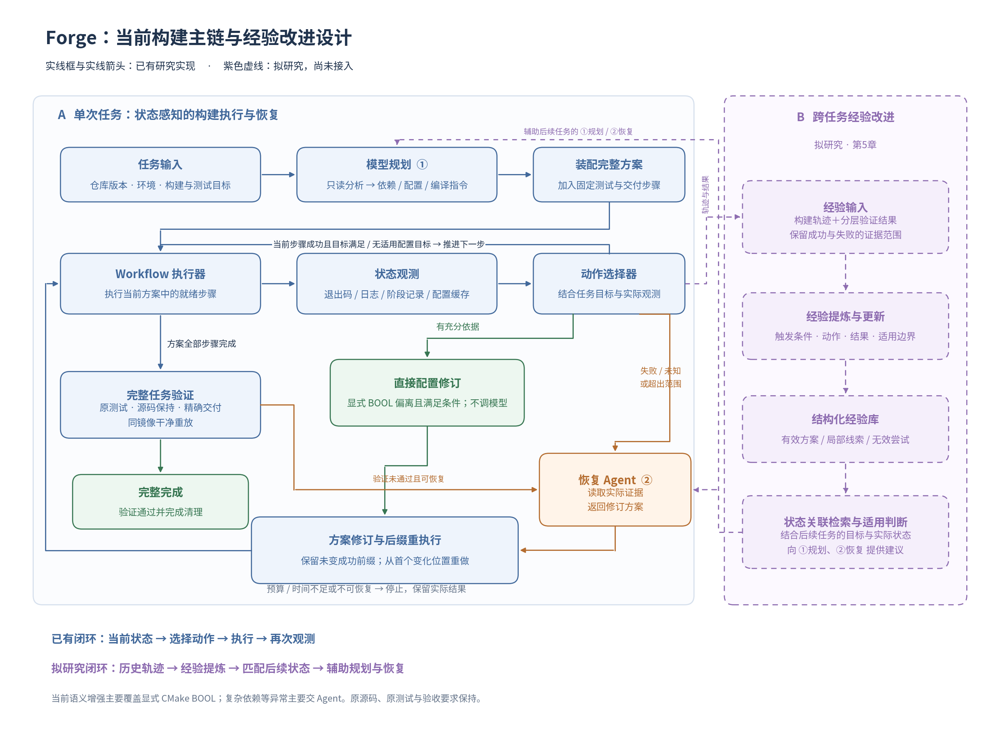

# 第3章 自动化构建任务建模与总体框架

## 3.1 任务输入、目标与约束

本文将一次构建任务解释为在给定环境中，对固定源码版本执行构建、测试与交付的过程。为便于描述，记任务为T=(R,E,G,V,A)，其中R是仓库与源码版本，E是运行环境，G是显式构建目标，V是原测试及其执行要求，A是指定交付集合与交付条件。该记号用于论文解释，不表示系统实现了通用任务语言或能够自动推导任意自然语言约束。

R至少包含仓库来源与精确commit；已有实验还可以绑定固定源码归档。E包含镜像身份、可用工具链、依赖资源及并行条件。G可包含必须启用的测试、示例或benchmark等配置要求。V包括测试入口和能够证明实际执行的输出依据。A定义需交付的程序、库及必要支持文件，而非允许将整个构建目录作为结果。

任务保留原源码、原测试和既有输入，允许构建系统正常新增生成文件。生成configure和辅助脚本可以是正常构建环节，但这不意味着允许改写原源码或删减原测试。若构建过程重写已受约束的原文件，仍需按对应实验的原判定记录，不能事后因功能正常而改为通过。

任务输出包含交付产物、构建与验证脚本、执行记录和最终状态。失败任务同样输出已观察进展与原因，未到达的验证层记为未观察。完整完成表示本任务声明的条件均满足，不承诺覆盖所有潜在功能或所有其他环境。

## 3.2 阶段、动作与执行依赖

### 3.2.1 宏观阶段与实现角色

从用户角度，可以将流程概括为依赖准备、配置、编译和后续验证四部分。从执行器角度，后续部分还需区分原测试、产物暂存、独立验证与干净重放。表3-1列出各阶段的典型输入输出。

| 阶段 | 主要工作 | 可观察结果 |
|---|---|---|
| 依赖准备 | 安装或构建依赖、准备必要工具 | 实际命令结果、已准备路径与工具 |
| 配置 | 生成辅助脚本、配置目标与构建目录 | 配置日志、缓存、生成的构建文件 |
| 编译 | 按目标执行编译与链接 | 命令结果、构建产物与必要输出 |
| 原测试 | 执行任务固定的作者测试 | 实际测试输出、退出码和执行记录 |
| 精确暂存 | 将指定产物复制到交付目录 | 文件集合、类型与内容 |
| 独立验证与重放 | 验证产物并在干净会话重建 | 重放结果、原/重放产物比较和清理状态 |

当前方案的动作角色包括dependency、configure、build、smoke和artifact_stage。smoke在此是实现中的验证步骤角色名，不意味着全部作者测试都只是简单命令行冒烟检查。独立重放由验证流程负责，不是模型可以任意替换的测试步骤。

### 3.2.2 构建方案表示

记方案P为按执行顺序组织的动作序列(a1,…,an)。每个动作包含标识、阶段角色、命令、工作目录、前置动作、依据和预期结果，必要时还包含必须出现的输出标记及诊断文件路径。前置关系用于判断某一步是否就绪，序列顺序用于确定当前实现的执行与修订边界。

动作具备执行条件，需要其前置动作已经成功，且成功记录仍属于当前方案和实际执行历史。模型给出的文字解释不是已执行证据；动作只有实际运行后才能形成命令记录。配置缓存、测试输出等进一步证据也必须关联真实运行，而不是从方案内容推断。

当前方法使用有序方案与前置条件，不声称实现了任意构建图上的最小增量重算。方案变化后的重执行采用保守后缀策略，第4章给出具体定义。

## 3.3 系统总体架构与数据流

图3-1展示已有研究主链与拟加入的经验模块。左侧实线是当前方法；右侧紫色虚线是尚未接入的经验驱动设计。图反映研究运行入口，不将所有实验控制器视为已完成的Web产品能力。

图3-1 当前构建主链与经验改进设计。模型负责初始方案和复杂异常分析，Workflow负责阶段进度，状态选择器利用真实观测选择动作，验证流程决定是否完成。

系统首先取得任务与源码，由规划角色通过只读工具读取仓库内容并生成依赖、配置与编译动作。装配模块加入共同源码准备、固定测试和交付步骤，得到完整方案。执行器逐步执行并记录结果；当步骤失败或配置目标存在偏离时，形成带实际证据的交接。

状态选择器允许对范围内的显式配置偏差执行一次直接修订，其他情况由恢复Agent返回修订方案。执行器比较新旧方案，保留仍有效进展并重做变化后缀。全部方案步骤完成后，产物提交进入独立验证与干净重放，最终清理完成才结束任务。

规划与恢复是两类职责，当前可以使用同一模型与只读工具底座。拟研究的局部工具恢复将扩展恢复角色的执行能力；经验提炼则在任务后工作，向后续任务的规划和恢复提供条件化建议。二者均不能反向改写已有实验中Agent的能力。

## 3.4 初始方案生成与共同装配

### 3.4.1 从仓库证据生成动作

规划Agent优先读取README、构建说明、构建文件与必要测试配置。当前工具提供目录列举、源码文本读取；恢复时还能读取交接指向的执行或重放日志。规划可以包含多轮读取、结构化输出与纠错，因此“一次初始规划”不等于“一次模型请求”。

方案中的依据字段用于说明指令来源，例如某个README段落或构建文件中的选项。它帮助解释模型决策，但不能保证指令正确。实际环境、依赖版本和可选目标是否满足，仍需执行与观测。

当前正式比较未提供通用联网检索。后续可在本地文档不足时查询官方文档或Issue，但应区分网络信息增强与编排方法的效果。将工具增加给一个方法后，不能把全部结果差异归于其状态策略。

### 3.4.2 固定任务条件的装配

构建动作与任务验证采用共同装配，避免模型在初始方案或修订时遗漏必须测试的端点。恢复不能删除、替换或降低固定测试与交付要求。项目需要何种测试依赖、配置开关或精确产物，在对应实验任务中公开说明；不把人工参考构建命令直接当成模型规划结果。

这种设计使初始规划负责项目特定动作，任务定义负责必须达到的终点。独立固定检查既为完成判定提供依据，也可以在构建退出0但目标缺失时触发恢复。它并不消除任务构造中的人工工作，第6章将其作为外部有效性边界说明。

## 3.5 执行记录、完整验证与干净重放

### 3.5.1 执行记录与有效进展

每个实际动作保存命令身份、角色、工作目录、开始结束时间、退出结果及日志。执行器用这些记录确认方案步骤，而不只维护模型自报的“已完成”列表。若执行历史与预期不一致，已有阶段结果不能直接沿用。当前保护可检测进入权威记录的外部命令变化，不代表能够发现任意未记录的文件写入。

逻辑上的成功记录与磁盘上的文件是两个对象。把旧步骤标为失效不会自动删除其生成物；依赖或配置修订需要显式清理的缓存和旧产物，应在新方案中表达。完整验证仍需针对最终有效状态执行。

### 3.5.2 六类观测与完成条件

既有实验常记录六类结果：构建命令、固定任务检查、精确交付、干净重放、原源码/链接保持和清理。固定任务检查同时涉及配置与原测试；为避免混淆，结果分析在必要时单列原测试是否实际运行及是否失败。

| 结果类别 | 要回答的问题 | 不能单独推出的结论 |
|---|---|---|
| 构建命令 | 最终命令是否按要求成功结束 | 测试和全部交付义务均已满足 |
| 固定任务检查 | 必需配置和原测试是否有效执行 | 不同环境中均正确 |
| 精确交付 | 指定文件集合及类型是否满足 | 文件可由完整声明步骤重新产生 |
| 干净重放 | 同镜像干净会话能否重建并匹配交付 | 跨平台、跨工具链均可复现 |
| 原源码与链接保持 | 受约束的原输入是否被改变 | 所有程序行为均正确 |
| 清理 | 会话资源是否按要求闭合 | 编译产物语义正确 |

清理属于运行条件，不能被包装为程序正确性。各层有各自的通过、拒绝和未观察状态，不能仅从最终终态倒推全部层，也不能把并列事实统计自动看成串行漏斗。

### 3.5.3 配方与独立重放

复现配方选择实际成功、必要且有序的依赖、配置、构建与暂存步骤，原测试记录进入验证脚本。诊断尝试和失败命令保留在完整轨迹中，不因最终成功被删除；它们不必全部进入最终执行配方。

干净重放使用与原任务相同的不可变镜像身份和空工作/交付目录，重新取得固定源码，执行配方和验证脚本，再比较交付集合、类型、大小、哈希与适用功能检查。该过程能够发现工作区里已经存在、却未被配方说明的生成物。字节一致条件也可能受时间宏等影响，因此它是本任务明确选择的可复现边界，不能等同为一般功能正确性。

## 3.6 本章小结

本章将自动化构建定义为具备固定输入、环境、目标、原测试和交付条件的任务，区分执行阶段、实际证据与完成判定。共同框架使正常步骤可以由Workflow推进，异常由状态选择器与Agent处理，并通过独立重放检查交付。下一章进一步说明状态如何产生、动作何时能够直接执行，以及方案修订怎样影响已有进展。
