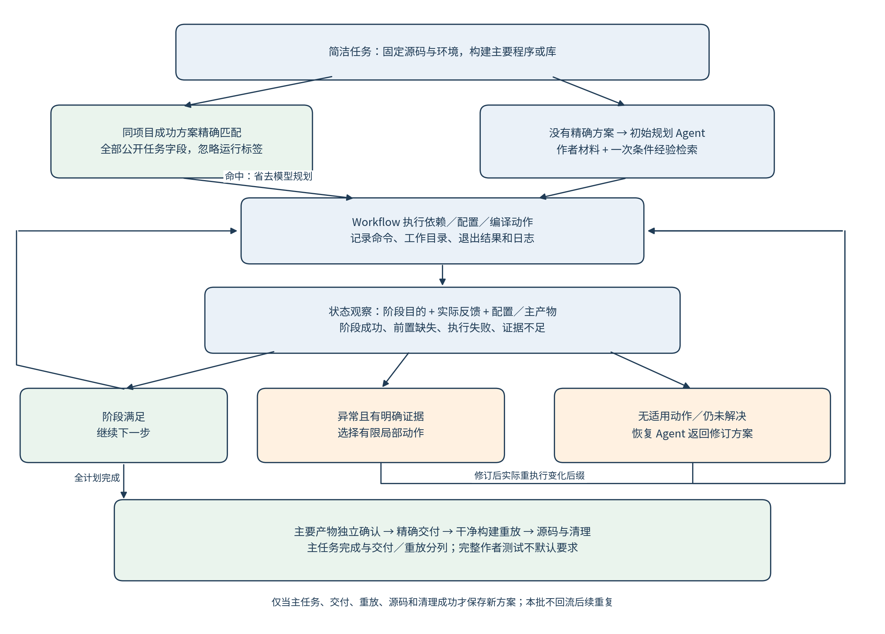

# 第3章 自动化构建任务建模与总体框架

## 3.1 任务输入、目标与约束

本文将一次构建任务解释为在给定环境中，对固定源码版本执行构建及所声明验证的过程。为便于描述，记任务为T=(R,E,G,V,A)，其中R是仓库与源码版本，E是运行环境，G是显式构建目标，V是该任务要求的验证及适用原测试，A是指定交付集合与交付条件。不同实验使用不同任务版本，比较只在相同版本内进行。

R至少包含仓库来源与精确commit；已有实验还可以绑定固定源码归档。E包含镜像身份、可用工具链、依赖资源及并行条件。G可包含必须启用的测试、示例或benchmark等配置要求。V包括测试入口和能够证明实际执行的输出依据。A定义需交付的程序、库及必要支持文件，而非允许将整个构建目录作为结果。

任务保留原源码、原测试和既有输入，允许构建系统正常新增生成文件。生成configure和辅助脚本可以是正常构建环节，但这不意味着允许改写原源码或删减原测试。源码保持检查比较构建前后的受保护文件。

任务输出包含交付产物、构建与验证脚本、执行记录和最终状态。失败任务同样输出已观察进展与原因，未到达的验证层记为未观察。完整完成表示本任务声明的条件均满足，其范围由T中的目标与验证要求确定。

### 3.1.1 简洁主构建目标与独立验证

新增`main-build-v1`以“构建仓库的主要程序或库，并确认有效产物”为主任务。给规划Agent的目的保持简洁，项目特定配置和命令由其根据作者文件生成；任务不默认增加完整测试套件、示例或benchmark要求。独立检查仍需知道本项目主要组件的身份，以区分真实产物与任意生成文件；组件参考属于评价依据，不把参考成功指令注入Agent，也不为每个项目改写Workflow控制逻辑。

执行成功、产物有效与完整功能正确性仍是不同概念。新范围保留原源码/测试保护，完整作者测试记为`not_required`，与通过状态分别统计。`primary_build_completed`表示成功构建记录与主要产物检查均满足；`main_build_task_completed`还要求原源码终态检查和清理通过。精确交付及干净构建重放作为独立指标报告。旧完整任务中的`full_completed`保留原义，不将旧测试未完成重新解释为新任务通过。

这一划分降低了公开目标复杂性，同时使论文能够分别回答“主要项目是否构建出来”和“构建过程能否完整交付与重放”。

## 3.2 阶段、动作与执行依赖

### 3.2.1 宏观阶段与实现角色

从用户角度，可以将流程概括为依赖准备、配置、编译和后续验证四部分。从执行器角度，后续部分还需区分原测试、产物暂存、独立验证与干净重放。表3-1列出各阶段的典型输入输出。

| 阶段 | 主要工作 | 可观察结果 |
|---|---|---|
| 依赖准备 | 安装或构建依赖、准备必要工具 | 实际命令结果、已准备路径与工具 |
| 配置 | 生成辅助脚本、配置目标与构建目录 | 配置日志、缓存、生成的构建文件 |
| 编译 | 按目标执行编译与链接 | 命令结果、构建产物与必要输出 |
| 原测试 | 执行任务固定的作者测试 | 实际测试输出、退出码和执行记录 |
| 精确暂存 | 将指定产物复制到交付目录 | 文件集合、类型与内容 |
| 独立验证与重放 | 验证产物并在干净会话重建 | 重放结果、原/重放产物比较和清理状态 |

历史完整方案的动作角色包括dependency、configure、build、smoke和artifact_stage。简洁主构建入口只让模型提交前三类动作，验证和交付由执行侧独立处理。smoke在此是实现中的验证步骤角色名，不意味着全部作者测试都只是简单命令行冒烟检查。独立重放由验证流程负责，不是模型可以任意替换的测试步骤。

新主构建入口采用结构化动作角色与实际执行记录确认阶段进展，再由主要产物检查确认构建结果。例如通过变量调用CMake时，Shell文本未直接出现标准构建形式，不应因此否认实际成功构建。角色声明本身仍不能证明成功：实际命令失败、缺少有效产物或改写受保护源码时均不能通过。该共同修复同时用于Workflow和强工具Agent提交，避免一个方法被额外文本识别门槛误拦。

### 3.2.2 构建方案表示

记方案P为按执行顺序组织的动作序列(a1,…,an)。每个动作包含标识、阶段角色、命令、工作目录、前置动作、依据和预期结果，历史版本必要时还包含输出标记及诊断文件路径。简洁入口已将这两类非核心字段移出模型动作提交范围，避免模型猜测断言或诊断路径阻断合理构建；原模型响应和完整系统日志仍保存。前置关系用于判断某一步是否就绪，序列顺序用于确定当前实现的执行与修订边界。

动作具备执行条件，需要其前置动作已经成功，且成功记录仍属于当前方案和实际执行历史。模型给出的文字解释不是已执行证据；动作只有实际运行后才能形成命令记录。配置缓存、测试输出等进一步证据也必须关联真实运行，而不是从方案内容推断。

当前方法使用有序方案与前置条件；方案变化后的重执行采用保守后缀策略，第4章给出具体定义。

## 3.3 系统总体架构与数据流

图3-1展示已有基础版本主链与经验模块的数据流。左侧实线中的恢复Agent返回修订方案；2026-11-02新增的工具辅助局部恢复在4.6节另述，不由此图表示其工具执行细节。右侧紫色虚线表示任务后的经验形成及面向后续任务的上下文通道，与左侧在线控制流区分。

图3-1 当前构建主链与经验改进设计。模型负责初始方案和复杂异常分析，Workflow负责阶段进度，状态选择器利用真实观测选择动作，验证流程决定是否完成。第5章5.4.3进一步扩展初始入口：命中可用的已验证同项目方案时，可以跳过模型规划，直接装配当前任务；后续执行、恢复与验证仍使用本图主链，两层复用的边界见图5-2。

系统首先取得任务与源码，由规划角色通过只读工具读取仓库内容并生成依赖、配置与编译动作。历史完整任务的装配模块加入共同源码准备、固定测试和交付步骤；简洁主构建入口执行仅含构建动作的方案，成功后再独立观察主要产物、暂存与重放，不自动追加作者完整测试。执行器逐步执行并记录结果；当步骤失败或配置目标存在偏离时，形成带实际证据的交接。

状态选择器允许对范围内的显式配置偏差执行一次直接修订，其他情况由恢复Agent返回修订方案。执行器比较新旧方案，保留仍有效进展并重做变化后缀。全部方案步骤完成后，产物提交进入独立验证与干净重放，最终清理完成才结束任务。

规划与恢复是两类职责，基础版本使用同一模型与只读工具底座。新增局部恢复扩展恢复角色，使其执行已纳入修订方案的构建动作并在目标满足后交还，详见4.6节及独立比较。经验提炼则在任务后工作，向后续规划和恢复提供条件化建议。

### 3.3.1 简洁主构建研究入口

图3-2单列当前简洁主构建范围，以避免旧完整任务的固定测试装配与新任务混淆。同项目方案精确命中后跳过规划；否则规划Agent依据作者材料生成动作。每次实际执行之后，Workflow使用阶段目的、退出状态、日志、配置和主要产物维护进展。正常阶段继续，具有明确原因和动作依据的异常局部修订，未覆盖原因交恢复Agent。恢复仍返回修订方案，执行和检查由Workflow完成，工具局部恢复则是独立研究分支。

图3-2 main-build-v1入口。主任务、交付和重放分别报告，作者完整测试不默认要求。状态案例来自实际轨迹，见6.6节。

## 3.4 初始方案生成与共同装配

### 3.4.1 从仓库证据生成动作

规划Agent优先读取README、构建说明、构建文件与必要测试配置。当前工具提供目录列举、源码文本读取；恢复时还能读取交接指向的执行或重放日志。规划可以包含多轮读取、结构化输出与纠错，因此“一次初始规划”不等于“一次模型请求”。

方案中的依据字段用于说明指令来源，例如某个README段落或构建文件中的选项。它帮助解释模型决策，但不能保证指令正确。实际环境、依赖版本和可选目标是否满足，仍需执行与观测。

本研究的规划主要使用仓库内作者材料；各组工具条件在比较前固定。

### 3.4.2 固定任务条件的装配

本节说明历史完整任务的共同装配，不能直接作为新main-build-v1的默认任务。历史任务将构建动作与固定验证共同装配，避免模型在修订时遗漏当时要求的测试端点。恢复不能删除、替换或降低固定测试与交付要求。项目需要何种测试依赖、配置开关或精确产物，在对应实验任务中公开说明；不把人工参考构建命令直接当成模型规划结果。

这种设计使初始规划负责项目特定动作，任务定义负责必须达到的终点。独立固定检查既为完成判定提供依据，也可以在构建退出0但目标缺失时触发恢复。项目主要组件参考由评价方事先整理。

## 3.5 执行记录、完整验证与干净重放

### 3.5.1 执行记录与有效进展

每个实际动作保存命令身份、角色、工作目录、开始结束时间、退出结果及日志。执行器用这些记录确认方案步骤，而不只维护模型自报的“已完成”列表。若执行历史与预期不一致，已有阶段结果不能直接沿用。命令历史与方案不一致时，系统使相应成功记录失效。

逻辑上的成功记录与磁盘上的文件是两个对象。把旧步骤标为失效不会自动删除其生成物；依赖或配置修订需要显式清理的缓存和旧产物，应在新方案中表达。完整验证仍需针对最终有效状态执行。

### 3.5.2 六类观测与完成条件

既有实验常记录六类结果：构建命令、固定任务检查、精确交付、干净重放、原源码/链接保持和清理。固定任务检查同时涉及配置与原测试；为避免混淆，结果分析在必要时单列原测试是否实际运行及是否失败。

| 结果类别 | 要回答的问题 | 不能单独推出的结论 |
|---|---|---|
| 构建命令 | 最终命令是否按要求成功结束 | 测试和全部交付义务均已满足 |
| 固定任务检查 | 必需配置和原测试是否有效执行 | 不同环境中均正确 |
| 精确交付 | 指定文件集合及类型是否满足 | 文件可由完整声明步骤重新产生 |
| 干净重放 | 同镜像干净会话能否重建并匹配交付 | 跨平台、跨工具链均可复现 |
| 原源码与链接保持 | 受约束的原输入是否被改变 | 所有程序行为均正确 |
| 清理 | 会话资源是否按要求闭合 | 编译产物语义正确 |

各层分别记录通过、拒绝和未观察；清理表示会话资源已释放，程序运行结果由产物与功能检查描述。

### 3.5.3 配方与独立重放

复现配方选择实际成功、必要且有序的依赖、配置、构建与暂存步骤，原测试记录进入验证脚本。诊断尝试和失败命令保留在完整轨迹中，不因最终成功被删除；它们不必全部进入最终执行配方。

干净重放使用与原任务相同的不可变镜像身份和空工作/交付目录，重新取得固定源码，执行配方和验证脚本，再检查交付集合、非空有效类型及相同轻量运行。大小、哈希和输出差异保留为诊断信息。该过程能够发现工作区里已经存在、却未被配方说明的依赖或生成物。早期实验曾将字节一致作为硬条件，对应结果在第6章按历史标准报告。

在线构建框架与离线优化角色分开。前者在任务内执行状态观测和动作选择；后者只消费指定开发轨迹并提出下一版本Harness。初始规划既承担作者文件理解，也承担阶段动作生成，不要求先新增完整解析器。共同缺陷修复后固定为H0，离线生成的策略在下一任务开始前选择，运行中不改变评价要求。

## 3.6 本章小结

本章将自动化构建定义为具备固定输入、环境、目标、原测试和交付条件的任务，区分执行阶段、实际证据与完成判定。共同框架使正常步骤可以由Workflow推进，异常由状态选择器与Agent处理，并通过独立重放检查交付。下一章进一步说明状态如何产生、动作何时能够直接执行，以及方案修订怎样影响已有进展。
