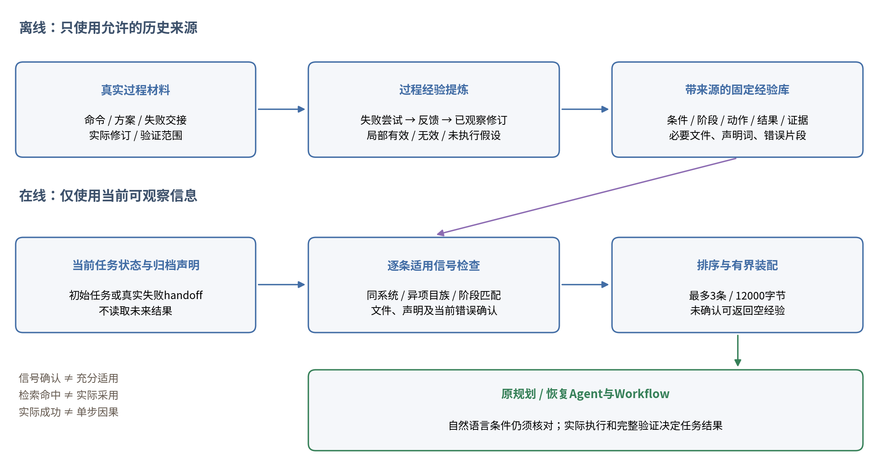
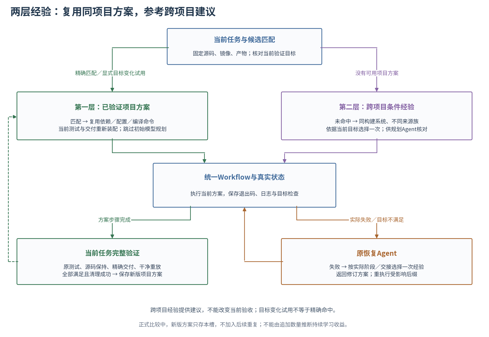

# 第5章 面向构建状态的经验驱动Harness改进方法

> 本章分别描述来源级经验基线、失败过程提炼和逐条适用性选择，并保留独立任务后更新。各版本的实验分母在第6章分别报告，实现与效果分开评价。

## 5.1 重复探索问题与研究目标

第4章主要利用当前任务证据处理执行问题，但每个新仓库仍可能重复分析曾经遇到的依赖、配置和交付困难。模型升级可以改变基础能力，改进Harness则可以在在线构建模型保持不变时提供更有针对性的信息。本文研究后者，目标是在不放宽任务要求的前提下改善规划与恢复；离线提炼使用独立模型，其额外计算与费用纳入评价。

经验机制已有相关研究[7–9]。本章的研究对象是构建领域的条件化经验：如何从实际轨迹提炼信息，如何结合当前状态判断可用，以及如何用验证反馈限定其可靠范围。单纯存储日志不是本章预期贡献；自动修改全部核心工具和控制代码也不属于初期范围。

研究区分三种任务关系。同项目在相同条件下再次构建，首先考虑直接复用已验证的阶段方案；没有同项目方案的新任务，使用跨项目经验辅助分析；任务后的新增经验是否让后续任务变好，则需要固定库与更新库的独立比较。前两者属于不同复用场景，第三者研究更新效果，不能由检索命中、成功保存方案或一次正向结果自动推出。

## 5.2 构建经验的提炼与表示

将经验条目表示为e=(C,S,A,O,V)：C是项目与环境条件，S是触发状态，A是动作建议或无效尝试，O是实际结果，V是验证范围与来源。最小实现采用带来源的JSON记录；索引和检索由程序执行，提炼角色使用独立模型调用，不依赖向量数据库或自动修改核心代码。

| 字段 | 记录内容 | 作用 |
|---|---|---|
| 条件C | 构建系统、工具链/依赖版本、目标和相关环境 | 避免跨环境机械照搬 |
| 状态S | 阶段、真实错误或配置偏差、已完成检查 | 与当前问题建立关联 |
| 动作A | 诊断步骤、修订方式及必要前提 | 支持候选决策，不直接授权执行 |
| 结果O | 成功、未解决或局部有效 | 区分完整配方与局部线索 |
| 证据V | 命令、日志、原测试、交付及重放范围 | 限定经验可信程度与可追溯来源 |

提炼时需要保留失败尝试和不适用条件。完整任务成功，不意味着轨迹中的每条命令均为成功原因；未完整完成，也不意味着全部诊断无价值。模型可以提出局部线索，但不能把未运行的测试或重放填为通过。

来源级基线汇集任务、命令、退出码、日志片段、原测试与重放记录，离线提示要求每轨迹最多两条候选经验，类型模式允许至多三条，再由校验绑定实际command_id。结果类型分为effective、ineffective、hypothesis；effective至少需要引用实际成功命令，但仍只说明局部观察。完整验收标签由程序从原结果附加，模型不能将未观察层升级为通过。当前只去除同次提炼的精确重复条目，不声称跨来源语义合并。用户私人知识库与正式实验经验库保持分离。

来源绑定是一项必要检查，而非经验内容的完备正确性证明。例如，一条建议可以引用真实成功命令，但对成功原因的解释仍可能不完整；程序并未重新执行每条经验，也没有自动证明条件的充分性。未知的来源字段保留为空，不以整体完成标签补成逐层通过。最终是否采用建议，由当前项目分析与真实执行决定。

以E30的check轨迹为例，提炼条目记录Autotools配置入口生成这一依赖准备状态，建议在运行autoreconf后检查configure与Makefile.in；条件包括项目确实使用Autotools、所需宏及工具可用、允许修改生成文件。不适用条件包括发布归档要求保持生成文件不变，或项目使用自定义bootstrap入口。条目绑定三条原命令，只支持该来源中准备步骤已成功，不证明任意Autotools项目均应先执行autoreconf。该实例是实际提炼输出，不是经验在评价任务中有效的证据。

### 5.2.1 失败过程与修订证据的补充

来源命令可以说明执行了什么，但无法完整表达“为何改变方案”。例如，方案被执行器拒绝后没有对应的失败Shell命令；只读取命令列表会漏掉这段过程。改进版本因此补充实际提交的方案、真实执行handoff和拒绝/禁用恢复事件，并保存原文件哈希与证据ID。它只使用原种子来源，不消费评价项目的构建答案。

改进条目在原五元组上增加失败尝试、实际反馈、已观察修订及适用信号。没有实际修订时记录为空；没有成功命令则不能标记为effective。命令ID与过程证据ID分开绑定，允许用方案或handoff解释未执行动作，但不能将方案当作已执行结果。每份来源至多两条，生成空列表和保留失败经验均合法。

| 新增字段 | 内容与约束 |
|---|---|
| failed_attempt | 实际无效动作或被拒方案；无失败可为空 |
| feedback | 来源中观察到的错误、拒绝或执行结果 |
| observed_revision | 后续真实修订；未修订为空 |
| evidence_ids | 实际命令、提交方案或handoff等过程证据 |
| applicability | 必要文件、作者声明字面词和当前错误标记 |

本轮原12来源形成19条新经验，其中14条为局部有效、5条为实际无效；8条包含失败尝试，只有3条存在已观察修订。新提炼用量158568 Token、估费0.158568美元、调用累计246.250秒。条目数量和字段完整性是材料统计，不是方法效果。这一设计改善提炼材料的过程完整性，但不能自动证明因果。若失败后同时改变多个步骤，记录的是已观察修订组合，不能把其中任意单一步骤宣称为充分原因。模型也仍可能给出过窄的条件或重复固定流程，因此需要独立评价选择与成本。

### 5.2.2 过程经验示例：配置退出成功但状态条件不成立

E30的simdutf来源展示了命令与状态判断的区别。CMake子命令成功返回，但方案随后要求检查build/build.ninja；实际所用Unix Makefiles生成器没有该文件，整个配置步骤因路径检查以86退出。后续真实修订移除生成器专属文件断言，保留CMakeCache.txt和构建目录检查，并继续通过cmake --build调用实际生成器。该过程说明，失败不总是缺少依赖或编译器报错，也可能是方案为当前生成器绑定了错误的成功条件。

| 过程元素 | 来源中的实际观察 | 可迁移范围 |
|---|---|---|
| 失败前状态 | CMake配置已经完成 | 不能将路径断言失败直接归为配置命令失败 |
| 无效要求 | 固定要求build.ninja存在 | 仅适用于实际选择Ninja的情况 |
| 错误反馈 | 配置返回后路径检查不满足 | 应同时阅读退出码和检查结果 |
| 已观察修订 | 改为生成器无关检查，继续cmake --build | 支持核对当前生成器，不能任意删掉任务要求 |
| 证据范围 | 来源中后续执行和验证完成 | 不证明此经验已在新项目中产生收益 |

该例子用于解释过程表示。它既不授权经验模块修改裁判，也不允许Agent为了通过检查移除固定原测试；可以修订的是其自行提出且不符合当前源码/环境的方案条件。评价任务的完成要求继续由原任务定义。

## 5.3 状态关联检索与适用性判断

初始规划时，检索条件来自仓库特征、目标和已知环境；异常恢复时，还应加入真实失败阶段、错误证据与已完成检查。两处使用相同经验表示，但可用观测不同，不能假定初始规划已经知道后续错误。

来源级基线先排除同项目族及不同构建系统的来源，再对共同原轨迹索引排序。设q为当前任务及真实交接中的词项集合、d为来源命令与日志词项集合，分数为|q∩d|/max(1,|q|)，当前阶段出现在来源命令角色中时另加1；同分按来源ID固定排序。初始阶段不使用未来错误。保留最多3个来源，上下文总额最多12000 UTF8字节，按完整材料装入并记录实际长度。该方法是透明的领域检索基线，环境版本、具体依赖等条件仍需规划/恢复角色核对，不是已训练的语义状态分类器。若依赖缺失、版本不符和路径不可见尚无法区分，应保持不确定，不能仅凭相似错误文本生成确定包安装动作。

词项提取对文本转小写后匹配`[a-z][a-z0-9_+.-]{2,}`，主要保留英文技术词、命令和标识符；当前没有中文分词、向量表示或依赖名称的语义归一化。在来源级对照中，该规则作用于共同的命令/日志索引，不以结构化条目的额外语义索引改善排序；逐条改进的索引与条件检查另见5.3.1。

算法5-1给出检索过程。原轨迹组与结构化组采用相同的来源排序，但每个来源的材料长度不同，因此实际装入的来源和Token数未必相同；共同字节上限用于限制资源，不代表两个上下文完全相等。当前实现不在排序后扫描全部来源补足预算，也不按经验效果调整排名。

原轨迹预处理先保留失败命令，再优先考虑配置和依赖角色；每条命令文本至多550字符、日志末段至多300字符，每来源片段列表不超过2800 UTF8字节，并标记其为片段及省略命令数量。因此“原轨迹组”是受限片段检索，不是完整成功配方重放。检索装入阶段不再截断JSON材料；共同12000字节是最大额度，不能据此声称实际字节、Token或信息量相等。

```text
输入：当前任务t、已发生的交接h、经验库K、材料模式m
q ← 当前任务与h的词项；s ← 实际失败阶段或initial
C ← K中构建系统相同、项目族不同的来源
对每个来源d：score(d) ← 词项覆盖率(q,d) + 当前阶段是否在d中
L ← 按score降序及来源ID升序取前三个
M ← 空材料；B ← 0
依次处理L中的来源d：
    x ← 原轨迹片段(d)，或来源d的结构化条目
    若x非空且完整JSON的UTF8长度+B ≤ 12000：装入x并更新B
返回M、实际来源ID与B；按原Harness继续规划或恢复
```

例如，“找不到某库”的经验只在实际确认库已安装、版本满足且元数据目录未被搜索时，才支持路径调整建议。旧机器路径应转换为当前环境中的检查与定位过程，不能照抄。这个例子是方法说明，尚不是经验迁移的实验结果。

如果实验希望把增益具体归于状态匹配，还需在相同经验内容下比较是否使用当前状态；无经验与结构化经验的比较只能说明组合方法的作用。

### 5.3.1 逐条经验的必要信号检查与拒绝注入



图5-1 失败过程经验提炼与逐条适用信号选择。离线形成固定库，在线仅使用当前已知信号；不满足必要条件时允许返回空经验。

来源级检索将同一轨迹的全部条目装入，可能把有用的配置经验与不相关的验证建议一并呈现。改进版本将候选单位改为单条经验：先排除同项目族和不同构建系统，再比较当前阶段并检查条目声明的必要信号。初始阶段没有未来错误；恢复时只使用当前真实handoff。

静态检查只读固定源码归档，枚举文件basename，并扫描不超过256KB的CMake、Make和Autotools构建声明。必要文件需实际存在，必要声明字面词需在这些声明中命中。当前错误标记必须出现在实际handoff中，多个错误片段满足其一即可。必要条件之间取逻辑与；缺少声明命中记为未确认，不能推断项目不存在该能力。未确认的候选可以拒绝注入，以避免模型先收到建议、再自行否定它的额外干扰。

当阶段为明确恢复阶段时，仅保留相同阶段经验；smoke与artifact_stage分别映射至verification和delivery。初始阶段允许跨阶段建议，但带错误条件的修复不能在尚无失败时通过。候选分数为当前词项与条目状态/动作/条件中的重叠数，加上每个已确认信号的固定权重3。没有显式信号且重叠词少于2的候选被视为相关性弱。同分按经验ID确定顺序；最多选择3条，完整装配不超过12000字节，不附加同来源其他条目。

```text
输入：当前任务、已发生的handoff、固定经验库、归档构建声明
对每条构建系统相同且项目族不同的经验e：
    检查阶段，以及必要文件/声明/当前错误信号
    若存在未确认条件或阶段不符：记录原因并跳过
    计算当前词项与条目内容的重叠分数
    若没有可检查信号且相关性弱：跳过
按分数与经验ID排序，逐条完整装入，最多3条/12000字节
若无候选通过：返回空经验，继续原规划或恢复
记录检查、拒绝原因、实际注入ID与字节数
```

程序只核对有限的必要信号，自然语言条件、依赖版本和充分适用性仍由Agent结合当前仓库判断。这不是训练得到的语义分类器，也没有证明完整前提。条件过窄可能过滤掉有用的迁移经验，条件过宽则仍可能带入干扰，因此将来源级检索与逐条选择放在同一新经验库下比较。实际Token与材料可不同，其差异属于选择机制的成本和效果，不能宣称纯等Token表示因果。

## 5.4 经验辅助规划与异常恢复

跨项目经验的接入点一是规划上下文。相关条目帮助模型检查测试开关、依赖准备或交付约定，输出仍需与当前仓库证据相容。它不应把其他项目的参考构建答案直接替换为当前模型输出。对于已经完整构建且满足匹配条件的同一项目，5.4.3另行定义可执行方案复用，两者承担不同角色。

接入点二是恢复上下文。经验帮助Agent优先检查更可能的原因，减少反复探索。实际修订或工具执行仍受当前任务约束，经验不能覆盖源码保持、原测试和完成条件。检索命中也不自动成为直接规则；直接动作是否允许，仍由其真实证据前提决定。

两个经验版本均固定方案式恢复和GoalStateWorkflow，在线规划与恢复均使用deepseek-flash。经验内容进入原有任务材料，不获得额外执行权限；无经验组也保留相同基础提示和实际状态。离线提炼请求RichLab的gpt-6-astra路由，首次响应标签gpt-5.6导致原身份停止，用户明确接受披露后才启动独立新身份。后续逐请求披露路由与响应标签，不据此证明实际后端模型身份或更强模型的因果作用。局部工具恢复仍作为已完成的独立研究保留，没有同时升级底座。

### 5.4.1 每次Agent任务固定选择与短动作经验

此前逐请求检索可能对同一问题反复返回相同材料。根据阶段式控制方式，后续实现将选择边界放在一次初始规划或一次新恢复任务的开始：任务开始时根据已有项目状态选择一次经验，将结果及哈希保存为快照；随后源码读取、模型交互与结构纠错均复用该快照。当前预算、工具反馈、失败日志和被拒方案仍动态更新。任务结束后，若另一个阶段出现新的失败并启动新恢复任务，再按新状态选择一次。空结果也缓存，避免同一任务重复执行无效查询。

减少本地选择次数不等于减少模型Token。固定材料仍随该任务的每次模型请求发送；若经验不能替代实际探索，它仍会增加上下文费用。因此需要分别统计任务选择次数、实际模型请求中的材料使用次数与字节、源码读取及总Token，不能以检索次数直接宣称成本收益。各组共用同一快照边界时，也不能把组间差异解释为快照机制的独立因果。

短动作表示进一步要求每条经验回答四个问题：什么前提下适用、应核对哪一项最小当前证据、优先执行什么、预期观察什么。新增check_before_action允许复用已读取证据，不要求重新读取整份源码；expected_observation只表示待验证预期，不能替代历史实际结果。每条仍保留失败、反馈、已观察修订和出处；含来源绑定最多3200 UTF8字节，最多选两条、总额6000字节。旧来源基线保持三来源/12000字节，因而比较的是材料、选择与额度的组合。

E38已从固定12来源提炼13条短经验，9条局部有效、4条未执行假设，全部提炼估费0.164217美元。在线比较在批入口中止，36槽均未观察，不能据此评价效果。固定初始任务的只读分析还发现，六项目均没有条目通过必要条件：来源专用选项、符号和文件被当作跨项目必需信号，错误与生成缓存前提也不能在初始满足。它提示来源事实与可迁移条件需要区别建模，不能通过删除必要条件制造命中；后续修订应以独立协议评价。第6章保留这一材料覆盖限制，不将提炼条目数量或入口修复写成模型收益。

### 5.4.2 来源事实与可迁移动作候选的分离

E38的空覆盖并不表明历史动作无用，而是说明来源事实与当前任务的适用前提不能共用一个字面匹配层。比如历史项目把特定测试程序注册到CTest，程序名是来源事实，注册测试这一构建结构才可能跨项目参考。若要求新项目具有相同程序名，会排除其他测试项目；若直接删除全部前提，又可能把不适用命令交给模型。

修订实现保留原条目和来源证据，不重新提炼或改写历史标签。派生上下文把完整原applicability标为source_applicability_examples，将选择分为三层。第一层核对同构建系统、不同来源项目族和当前阶段；初始规划允许参考后续阶段，实际恢复要求相应阶段。第二层只确认有限通用结构：构建输入文件、声明文本中的CMake函数形态或Make通用目标声明；修复类经验仍须当前失败片段命中。该层采用词项与模式匹配，不建立AST或求值配置分支，因此文本命中不证明相应功能已在当前配置启用。第三层将自然语言前提、版本、依赖位置、来源选项和目标交给当前Agent核对并实例化；不满足则忽略。前两层只是相关性筛选，不能证明第三层条件已经成立。

例如find_package(doctest)可抽取find_package函数结构，但它不证明当前项目也依赖doctest，更不授权安装该库。add_test中的来源测试名仍留在实例中，Agent应结合当前作者声明确定实际程序。生成物清理也仍需当前路径身份的证据，不能因文件名相同删除作者原文件。原源码保持与测试要求由共同执行和验证层继续约束，经验不获得额外权限。

具体选择以已确认信号数乘3加原词项重叠排序，同分按条目ID固定。所有抽出的通用信号取AND，错误片段内部取OR且只查询当前handoff；未确认则放弃。没有可抽取声明时，通用构建输入仅支持同构建系统的粗候选。最多两条、6000字节及每任务一次快照保持。该方法没有训练语义分类器，也不把候选命中改称状态识别准确率。静态覆盖和后续动作采用、完整结果及全部费用需要分别评价。

### 5.4.3 同项目方案复用与跨项目经验的两层使用

此前经验实验主要研究其他项目轨迹对当前规划或恢复的帮助，并在来源选择时排除同项目族。对于曾经完整构建的同一项目，重新把成功指令转述为自然语言，再交给模型生成相似指令，会引入不必要的规划。为此，本文补充两层使用方式：项目方案库保存可执行阶段命令及其适用条件；跨项目经验库保存需要当前证据核对的条件建议。项目身份相同只用于找到候选，直接执行还需检查源码版本、归档、镜像、构建系统和目标产物。



图5-2 两层经验共享当前任务、Workflow和完整验证。绿色回流表示成功方案保存；正式比较中新版只存本槽，不在后续重复中使用。初始规划未命中可用方案时才进入第二层，执行失败后的恢复仍使用当前实际证据。

项目方案由程序从完整成功轨迹的最终方案中提取依赖、配置、编译动作，保留原命令及可执行检查。测试与交付始终依据当前任务重新装配，历史测试不能覆盖当前要求。程序逐字段核对仓库URL、完整commit、源码归档SHA-256、完整镜像ID、构建系统及产物路径列表，再比较verification_steps字段；它采用保守的结构化相等判断，不推断两份不同自然语言目标在语义上等价。精确匹配时可跳过模型规划，直接创建新的Workflow执行；没有合适方案时仍走初始规划。对于目标变化而源码、环境及产物不变的情况，系统单独标记为候选试用，默认不当作精确命中。本章对应实验前瞻启用该模式，以观察Release到Debug变化产生的失败和恢复代价，不据此声称支持任意版本或工具链迁移。

每次方案复用仍在干净工作区实际执行编译、测试与交付，并另做同镜像干净重放；其直接节约对象是重复规划和探索。当复用方案执行失败，当前执行记录形成真实交接，继续由原恢复Agent提交修订；Workflow重新执行受影响后缀并完成当前全部要求。只有任务完整成功、源码保持、干净重放及清理通过，程序才保存新版配方。失败和未观察轨迹保留，但不升级为已验证配方。实验中新版只保存在本槽，后续重复仍从同一初始库开始，因此不能把追加动作本身视为持续学习收益。

跨项目比较进一步固定原24条经验及其文字表示，改变选择策略以减少材料变化的混杂。新选择将当前产物及固定验证目标构成目标词项集G，将真实失败交接构成失败词项集F；经验条件、状态、动作与不适用描述构成词项集T_e。英文构建标识和中文相邻二字词均保留，长哈希不作为相关性信号。条目得分为|G∩T_e|+3|F∩T_e|，恢复时只对同阶段条目评分。来源分数取该来源候选条目的最大值，再按来源编号打破同分；无相关信号则弃权。

本次仍按来源组装全部原条目，最多三来源、12000 UTF-8字节，与旧检索共用表示、材料装配和额度。恢复时的同阶段过滤仅用于来源排序，不意味着注入的整个来源材料均属于同阶段。它是可复现的词项排序方法，没有训练语义分类器；当前目标特征与排序一起改变，不能由结果隔离出纯阶段匹配的因果。两种检索实际Token可不同，费用按真实发送材料计量。初始规划及每次新恢复仍各选择一次，任务内部快照保持不变。

E40的rang首重复提供一个实际实例。历史方案来自E30-slot-19，核心配置为`cmake -S . -B build -DCMAKE_BUILD_TYPE=Release -Ddoctest_DIR=/workspace/repo/.forge-deps/install/lib/cmake/doctest`，后续编译作者的`all_rang_tests`、`colorTest`与`envTermMissing`。本次任务要求Debug，显式试用旧方案后，当前profile检查不通过，形成真实恢复交接。恢复Agent将配置改为Debug，保留依赖位置和作者编译目标；Workflow从变化位置重新执行，最终原测试、交付及干净重放通过。原方案及修订仍含产物路径断言，完整命令见该槽的plan-1.json和plan-2.json；这里仅摘出配置核心。该例说明旧成功方案不能代替当前状态检查，也说明在目标变化时直接复用可能先执行一次无效旧配置。第6章同时计入这部分耗时和恢复费用。

成本评价区分历史获取与当前使用。项目方案提取无需新增模型调用，但历史成功构建包含规划、失败及恢复费用；若从零建设方案库，这部分成本不能省略。跨项目检索两组共享同一已有库，新增制库费均为0，部署成本另列一次。在线费用必须包含目标变化后的全部失败与恢复，不能只统计被跳过的初始规划。

算法5-3给出两层使用的控制逻辑，其效果由第6章对应独立比较评价。

```text
输入：当前任务t、项目方案库R、固定条件经验库K
按仓库与构建条件查找候选配方r
若r精确匹配，或当前范围明确允许记录目标变化试用：
    用r的阶段命令与t的固定测试/交付装配方案，跳过模型规划
否则：
    根据当前目标从K选择一次经验，交由规划Agent生成方案
由Workflow执行；失败时：
    根据真实阶段/交接选择一次恢复经验，调用原恢复Agent
    修订后由Workflow重新执行受影响部分，继续完整验证
若当前任务完整通过：保存新版本配方及其适用条件
否则：保留失败轨迹，不登记成功配方
正式重复比较中，每槽均从相同初始R与K开始
```

## 5.5 执行反馈与持续更新

任务结束后，候选更新依据实际轨迹和验证结果进行。当前最小更新为追加来源和经校验的新条目，保留历史结果与来源，不自动覆盖、降权或生成新规则。冲突建议在条目中保留其条件与不适用范围，仍由当前任务证据判断。此处研究经验内容的更新，不将其表述为递归改写整个Harness。

若研究持续更新，第t个任务只能使用此前任务形成的经验库K_t；本任务的结果可用于生成K_(t+1)，不能先用于帮助自身正式评价。固定库与更新库应从相同种子开始，并在相同任务序列下比较。后期任务表现较好可能来自任务难度或顺序，因此不能仅凭时间趋势证明学习。

算法5-2体现更新发生的时间边界。它不是修改模型参数或在线改写控制器；提炼失败时保留原响应与费用，内容未通过校验则不形成可用条目。正式构建失败也可以成为经验来源，其未观察验证层保持未观察。

```text
输入：固定种子K0、预先固定的任务序列t1…tn
固定库组在每个任务始终读取K0
更新库组令K ← K0，并依次处理任务ti：
    使用当前K进行规划、Workflow执行、恢复和完整验证
    保存本任务的原始结果及全部费用
    仅在任务终结后提炼本任务经验，并绑定实际命令和观测范围
    将来源和通过校验的条目追加到K，供后续不同项目使用
两组分别报告全部构建费用；更新组额外报告任务后提炼费用
```

经验提炼和维护也有费用。实验应报告构建、恢复、经验生成与更新的全部模型成本；若讨论摊销，应明确后续使用次数。只报告检索时开销，会低估经验机制代价。

本轮复用此前已采集的历史轨迹，新增准备费包含本次提炼，不重复计入旧实验采集成本。因此其经济性分析对应已有轨迹的复用场景，不能表述为从零建立经验系统的全生命周期成本。持续更新比较中新发生的构建和任务后提炼费用则全部计算。

## 5.6 方法流程与比较假设

方法流程为：历史任务轨迹与验证结果 → 条件化经验提炼 → 保存与检索 → 当前任务适用性判断 → 辅助规划/恢复 → 本任务执行与验证 → 更新后续可用经验。

E35主比较固定六个评价项目、两次重复、三种经验处理，共36次；来源为另外项目族的12条历史轨迹，包含成功与失败。原轨迹与结构化组共享来源索引与上下文额度，比较提炼和使用的组合增量。E36另独立执行六任务的固定库/更新库12次比较，更新组只能使用此前任务形成的新经验；主36次结果不加入更新实验种子。E35没有单独的状态匹配开关，不能将组合差异全部归于状态匹配。E37独立四组比较保留无经验、旧经验/来源检索、新过程经验/来源检索、同新库/逐条适用性选择，六项目各两重复，共48次。B-C评估提炼材料与表示组合，C-D评估逐条选择与信号核对组合；仍不等同学习型状态分类器或完整语义前提的因果识别。E39再以独立36次比较无经验、旧来源与短动作迁移候选，统一每任务快照；分开观察初始读取与后续恢复，并按预先构建系统分层区分非空和空材料。评价对象应包含完整完成、全部成本、时间、恢复请求，以及不适用和负迁移案例。

E40进一步用六同项目任务、两重复、重新规划/方案复用的24次比较，检验省去规划及目标变化恢复；其中三个原条件、三个前瞻Debug变化。E41另用六跨项目任务、两重复、三处理的36次比较，固定24条经验文字与材料额度，检验原来源和状态目标选择的差异。二者独立统计，不把目标变化试用称精确命中，也不把本槽成功后保存称跨重复学习。

效果可以表现为提高完成、降低探索费用，或以额外开销换取更多完成，不预设必须每项指标占优。若没有观察到增量，应报告原因并限制主张。方法评价同时报告新增在线成本与已有方案/经验的获取成本，区分复用已有资产和从零部署的成本。

## 5.7 本章小结

本章围绕固定模型下的构建经验复用提出状态关联表示、适用判断和反馈更新设计，与第4章共享任务目标、状态和动作证据。两层使用进一步区分可执行的同项目阶段方案与供模型核对的跨项目建议，并将成功后保存限制在实际验证范围。当前实现支持经验提炼、检索、注入及任务后更新；各独立比较评价相应版本的实际效果，既有基础系统实验不替代新增组件评价。下一章分别报告基础方法与独立经验结果，并保留模型标签、样本暴露和成本摊销边界。
