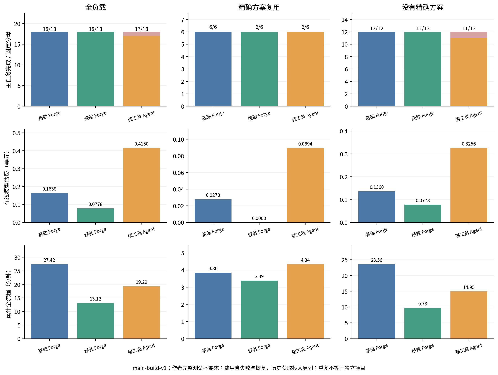
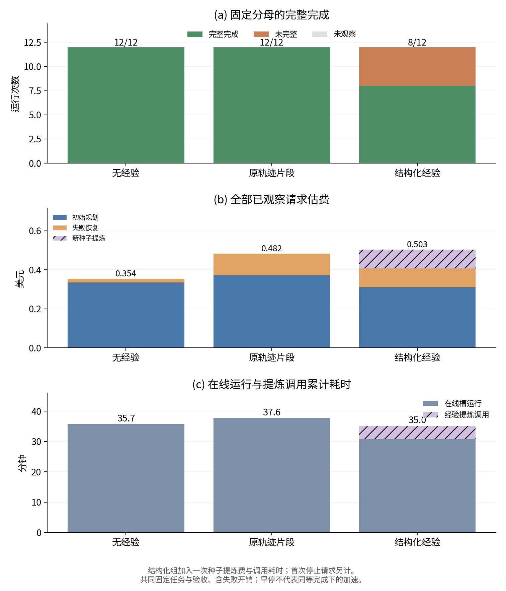
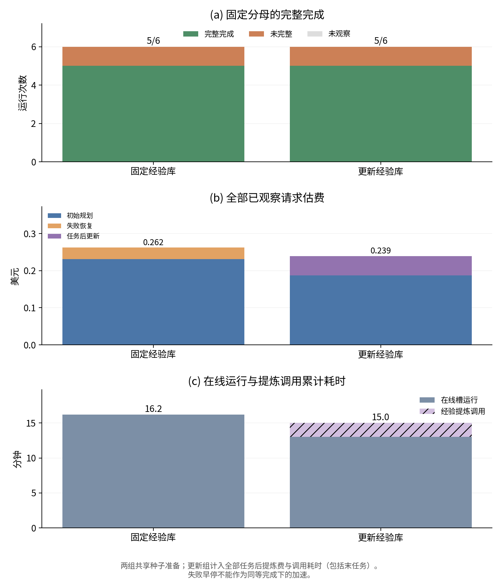
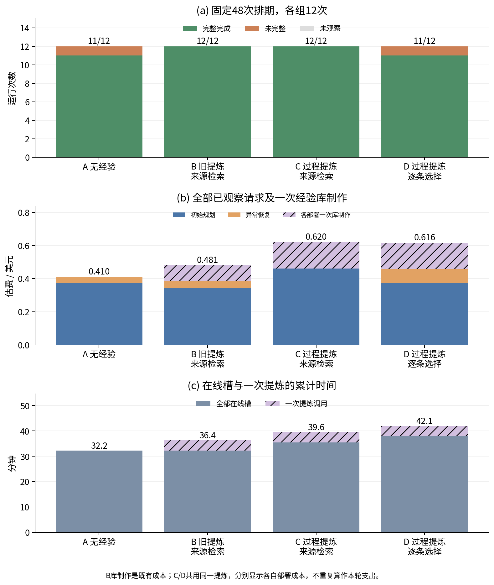
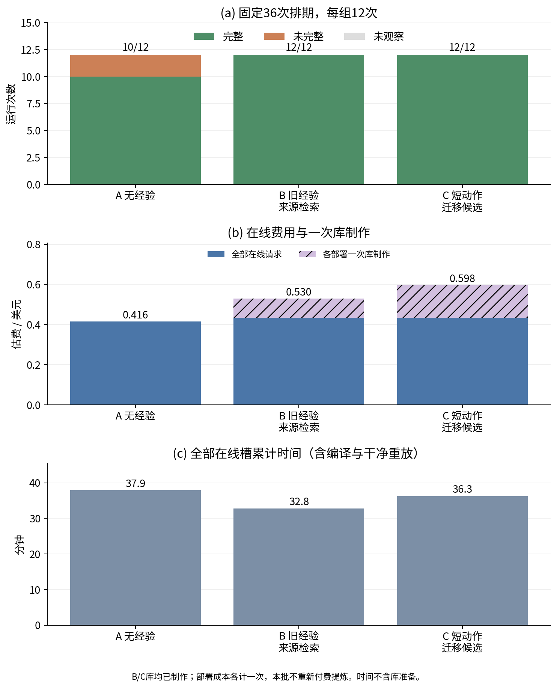
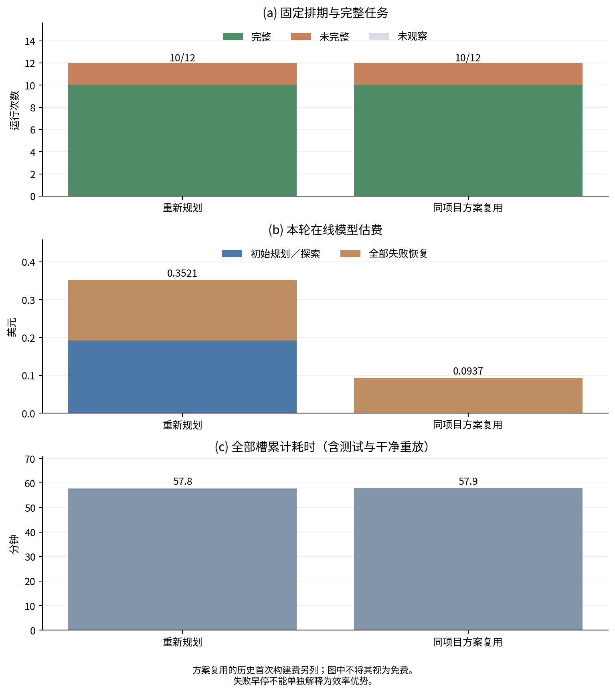
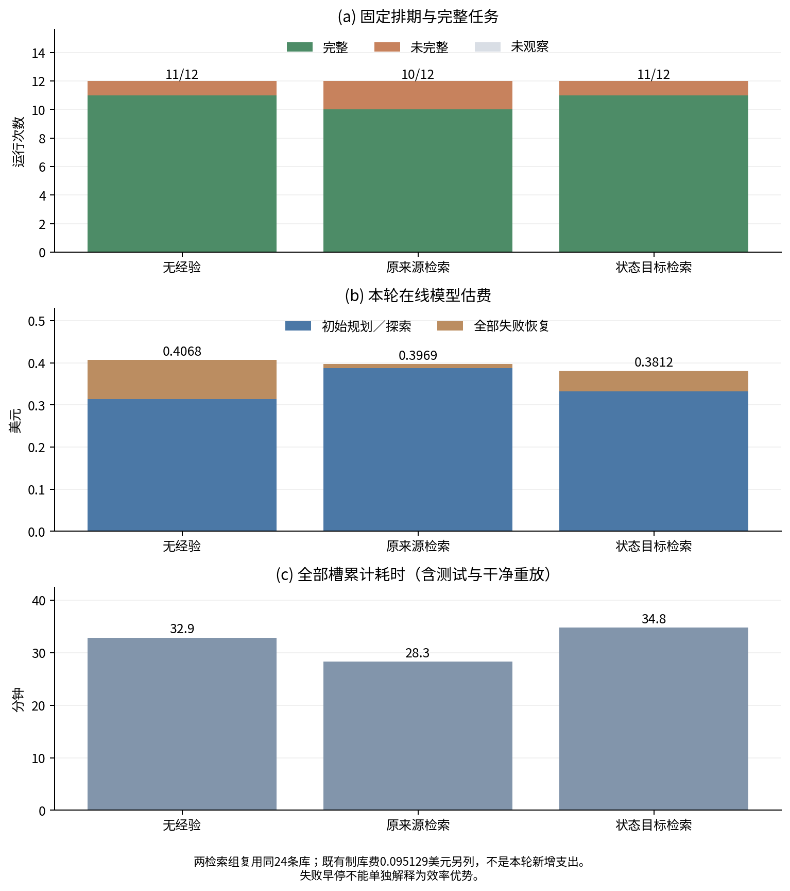

# 第6章 实验设计与结果分析

## 6.1 研究问题、任务与实验设置

### 6.1.1 研究问题与实验组织

本章使用已冻结的实验报告组织基础方法与新增经验结果，不将工程测试数量计作模型效果。RQ1评价完整系统的完成与开销；RQ2分别研究状态观察、直接修订及失败恢复；RQ3解释构建、原测试、交付和重放之间的缺口；RQ4分别检验经验复用、任务后经验库追加与历史轨迹驱动的离线Harness更新。最后一项由E51首轮24次固定版本比较回答，不将已有组件结果当成完整优化闭环效果。

本轮另补充E51离线规划Harness首轮24次比较，初始提示为唯一变化；E50简洁主构建54次完整系统比较继续作为系统主表，Jev不参与；近期另有E42简洁任务48次、E44/E45两批各16次规划路由、E46/E47各16次经验比较、E48两层系统36次及E49中断记录，均按原身份独立解释。主要历史实验包括E30完整系统48槽、E33独立24槽续段、E01固定初始方案30槽、E02独立规划18槽、E04恢复开关10槽、E34两批恢复接口比较，以及E35经验复用36槽、E36独立更新12槽、E37过程经验/适用性选择48槽、E39短动作迁移36槽、E40同项目方案复用24槽及E41固定库检索36槽。一次槽表示一个方法在一个固定任务/重复条件下的实际运行。重复次数不等于独立项目数，不同实验身份不合并为一个成功率。E16–E19是验证分析与控制材料，其中存在对原运行的重复使用。

表6-1列出各实验要回答的问题。实验身份见附录B，任务清单和原始指针由论文证据索引链接至各报告与manifest。

| 编号 | 比较设计与观察分母 | 主要用途 |
|---|---|---|
| E51 | 九条历史开发轨迹→一次提案→六项目×两重复×H0/H1，共24次 | 固定在线模型下离线Harness更新及采用决策 |
| E30 | 8个已见任务×2重复×3方法，48/48运行 | 基础完整系统效果与成本 |
| E33 | 原排期未启动的24槽，3方法各8次；7项目，其中FSE重复2次 | 新于当前方法调试的项目补充与失败分析 |
| E01 | 5份自然初始方案×2重复×3处理，来自3项目，共30槽 | 相同方案下区分观察时机与直接动作 |
| E02 | 3项目×2重复×3处理，各自规划，共18槽 | 目标保持、配置状态的整体取舍与混杂 |
| E04 | 5任务×有/无失败恢复，共10槽 | 相同工具方案的恢复开关作用 |
| E34 | 五方案×两重复×两方式共20槽；独立材料修复后两偏离方案共8槽，分别统计 | 恢复接口组合与实际交还的独立评价 |
| E35 | 六项目×两重复×无经验/原轨迹片段/结构化经验，共36槽 | 相同基础方法下的经验提炼及使用组合增量 |
| E36 | 同六项目×固定库/更新库各一次，共12槽 | 共同种子下任务后追加的探索性比较 |
| E37 | 六项目×两重复×四处理，共48槽 | 失败过程材料与逐条适用性选择的独立增量比较 |
| E39 | 六项目×两重复×三处理，共36槽 | 短动作迁移表示与初始/恢复探索取舍 |
| E40 | 六项目×两重复×重新规划/方案复用，共24槽 | 同项目已验证方案省去规划与目标变化恢复 |
| E41 | 六项目×两重复×三检索处理，共36槽 | 同24条经验库下的来源检索与状态目标选择 |
| E42 | 六项目×两重复×四方法，共48次 | 简洁目标下系统比较与规划失败 |
| E44/E45 | 四项目×两重复×两规划路由；独立各16次 | 同一经验系统内的规划路由敏感性 |
| E46/E47 | 四项目×两重复×两方法；独立各16次 | 分别检验跨项目建议与同项目复用 |
| E48 | 三复用/三无方案项目×两重复×三方法，共36次 | 两层经验联合系统的成本与时间取舍 |
| E49 | 原24计划槽，3终态/21未启动 | 新任务工程路径与Jev服务中断边界 |
| E50 | 九开发项目×两重复×三方法，54/54终态 | 主构建范围下系统效果、精确复用/无方案分层及长尾 |
| E16–E19 | 固定队列回顾与7项正负控制 | 验证缺口、状态变化与具体反例 |

### 6.1.2 模型、方法与公平性

本章主要Flash实验统一使用deepseek-flash及相应协议规定的thinking条件。系统比较中冻结源码、镜像、依赖资源与并行条件；E30/E33的CMake使用build目录和Release，Make/Autotools保留作者默认优化。历史Pro批次可作补充，不能与Flash批次相减解释模型变化。

Forge基础系统由模型规划、Workflow、适用配置观察与失败Agent组成。强工具Agent获得共同完整任务与提交判定，通过自己的工具循环执行和修复。完整系统比较包含编排、工具使用与交互方式等差异，不是三个方法Harness完全相同的规划单因素实验。

CXXCrafter采用固定社区快照及已有运行修复，保留原生Parser、Generator、Modifier与Judge等流程。外部验证失败不回其原生Modifier，CPU约束实现也有差异；进一步核实其外部检查没有Forge提交端额外的默认可执行文件smoke。因此主要同判定比较为Forge与强工具Agent，CXX数据仅作外部实现参考，不据此宣称论文原版方法排名。

### 6.1.3 指标与计数口径

主要指标是相应任务完成数、全部模型估费、模型请求和墙钟时间。E50的main-build-v1以主要产物、源码保持及cleanup定义主任务，精确交付与干净构建重放分列；作者完整测试不要求，不记为通过。历史完整任务仍按原测试及其他义务判断，不把新范围重标旧结果。完整完成由对应实验全部任务条件决定，未到达的层记未观察。最终通过不删除中间失败；原测试失败、额外模型断言失败和裁判启动错误分别解释。

对Flash批次，报告使用输入每百万Token 0.30美元、输出1.20美元的冻结费率，全部输入按缓存未命中保守估算：C=(0.30×N_in+1.20×N_out)/10^6。它不是实际账户账单，也不是对未来模型价格的说明。初始读取、输出、结构纠错、失败恢复及相应方法内部Judge均计入，不能只计算成功尝试。

累计槽时间是各运行持续时间之和，不等于并行批次的总历时，也不只是编译器耗时。E01与E34复用固定历史方案，报告的新鲜执行时间不包含重新规划；其费用比较另列共同历史规划费用。不能把这些执行时间直接作为新的端到端规划时间。

成功率高低与费用必须结合看。失败后早停可以降低花费，却不意味着同等完成条件下更高效。共同成功子集仅辅助分析，因其按结果条件化，不能替代固定分母主表。

## 6.2 RQ1：完整构建系统的效果与开销

### 6.2.1 八个已见任务上的48次比较

E30任务为check、libtommath、tinyxml2、simdutf、snappy、yaml-cpp、rang与ELFIO，覆盖Autotools、Make和CMake。rang/ELFIO是header-only库的作者编译端点，不能将八任务全部描述为大型C++项目。每方法每项目运行两次，顺序在运行前轮换。

| 方法 | 完整/计划 | 请求 | recorded Token | 全部估费/美元 | 累计槽分钟 |
|---|---:|---:|---:|---:|---:|
| Forge状态Workflow | 16/16 | 84 | 1,485,048 | 0.5121477 | 60.70 |
| 强工具Agent | 16/16 | 145 | 2,140,806 | 0.6639255 | 62.39 |
| CXXCrafter社区版（参考） | 13/16 | 109 | 1,060,573 | 0.5554065 | 96.52 |

表6-2 E30完整系统结果。CXX判定与反馈差异限制三方排名，主要比较为前两行。

Forge与强工具均完成16次，Forge全部估费低22.9%、请求少42.1%，累计时间低2.7%。费用下降是本批较清晰的观察，时间接近；CMake层两者累计耗时几乎相同，不能据小幅总体差宣称稳定加速。逐项目上，check和simdutf的Forge费用更高，其余六项更低，保留项目相关取舍。

Forge初始规划71请求、0.3874764美元，恢复13请求、0.1246713美元。13个任务无需恢复即完成，另3个任务经历4次恢复episode后完成。由此可见，规划不是固定一次请求，恢复也可能在同一构建中多次发生。

本批14次配置观测均满足，直接配置修订0次。因此该实验支持完整方法的成本价值，但不能把费用差全部归因于直接动作。组件的作用需由6.3节回答。

### 6.2.2 独立24槽续段结果

E33只执行父排期原19—42个未启动槽，不重试旧失败或中断。每方法8次，包括FSE两次及jsoncpp、PEGTL、inja、highwayhash、libsigcplusplus、libsrtp各一次。旧E32的17终态、1中断和原42分母保持，不能将两身份写成原42槽单一完整实验。

| 方法 | 完整/计划 | 请求 | 全部估费/美元 | 累计槽分钟 |
|---|---:|---:|---:|---:|
| Forge状态Workflow | 6/8 | 38 | 0.2411922 | 31.23 |
| 强工具Agent | 5/8 | 175 | 0.8869458 | 54.70 |
| CXXCrafter社区版（参考） | 6/8 | 55 | 0.2542455 | 77.45 |

表6-3 E33独立续段固定分母结果。完整数不同，全部费用差包含失败开销差异。

全部槽上Forge估费较强工具低72.8%、累计时间低42.9%，但失败开销影响很大，不能将其解释为每个共同成功项目的效率提升。五组共同完整任务的辅助比较如下。

| 方法 | 共同完整 | 估费/美元 | 累计槽分钟 |
|---|---:|---:|---:|
| Forge状态Workflow | 5/5 | 0.1406295 | 12.15 |
| 强工具Agent | 5/5 | 0.1662762 | 11.76 |

表6-4 E33共同成功子集，按最终结果条件化，仅辅助解释效率。

在该子集中，Forge估费低15.4%，时间高3.4%，显示费用收益与时间取舍。highwayhash和libsrtp的Forge费用均高于强工具，不能仅报告总体有利数字。初始规划33请求、0.1859694美元，恢复5请求、0.0552228美元；6个任务无需恢复即完整，两个FSE槽的恢复均未达到完整完成。

本批6次配置观测全部满足，直接动作仍为0，不能增加直接修订效果的样本数。项目新于当前方法调试，不等于从未暴露于任何历史准备或模型训练；不称盲holdout或随机仓库总体。

### 6.2.3 简洁目标下的系统演进与完整36次比较

E42将公开任务统一为依据作者说明构建主要程序或库，比较六项目、两重复、基础Forge、经验Forge、强工具Agent和CXX社区参考，共48次。此时独立检查仍包含作者完整测试，故公开目标简洁不等于只检查主产物。基础、经验、强工具和CXX的主构建分别9/12、8/12、12/12、12/12，记录完整分别9/12、8/12、12/12、9/12。基础与经验的七次未完成发生于规划交付前，包括结构化输出被拒和读取循环；后续编译、测试与重放未观察，不能说成编译器执行失败。经验192请求、0.9172332美元高于基础58请求、0.1942293美元，本版未取得总体优势。CXX的三次测试未完整又包含构建系统切换后的检查入口不适用，仍只作外部参考。

据原轨迹依次修复规划正文/工具提交出口、一次显式纠正、上下文保留与压缩，以及非核心诊断字段对动作提交的阻断。E43、E44的原失败仍保存，工程回放不增加方法效果分母。E48在共同修复后的执行入口上完成六项目×两重复×三方法的36次独立系统比较。三项目具有事先冻结的同项目成功方案，三项目没有可复用方案，二者各占一半；本批没有在线提炼或将前一槽结果读回下一槽。

| 方法（各12次） | 记录主构建 | 旧完整任务 | 全部请求 | 在线估费/美元 | 累计秒 |
|---|---:|---:|---:|---:|---:|
| 基础Forge | 12/12 | 10/12 | 40 | 0.1374321 | 721.91 |
| 两层经验Forge | 11/12 | 10/12 | 20 | 0.0850560 | 796.31 |
| 强工具Agent | 12/12 | 10/12 | 82 | 0.2161467 | 707.80 |

表6-5 E48完整系统比较。任务包含独立作者测试，与后续main-build-v1分开。

在固定混合负载上，基础相对强工具在线费低36.4%、请求少51.2%，累计时间高2.0%；经验相对基础在线费低38.1%、请求少50.0%，累计时间高10.3%。两种比较均有费用与耗时取舍，不支持整体稳定加速。三方法的六次未完整均来自double-conversion：经验首重复已有有效静态库，却因Shell变量形式的CMake调用未被命令角色识别；其余五次主库、交付和构建重放通过，但作者默认未开启BUILD_TESTING，独立CTest未发现测试。后者是测试未注册，不是实际测试用例失败。新命令修复与新任务范围都不回填旧结果。

同项目方案层中，三方法各6/6完整，经验全部零模型。相对基础，经验累计266.84秒低于300.57秒，即低11.2%；每次仍从源码重建、执行检查和干净重放。无方案层各方法完整4/6，经验未呈稳定收益：三方共同完整的libogg/xxhash四对中，经验费用反高18.1%，仅作按结果条件化的辅助分析。整体费用收益不能全部解释为跨项目泛化。

三份方案来源费0.0150984美元与旧库制备费0.095129美元另列。若将两者一次性全额归入该经验部署，总模型成本0.1952834美元，高于基础在线0.1374321美元；精确复用单独部署不必承担无关建议库成本。该情景说明零在线规划费并非零投入，也不能用六次重复测量推断长期回本。E42/E48的样本、共同接口和任务条件不同，不以跨批完成差值估计修复因果。

### 6.2.4 初始规划路由的敏感性比较

为检验更换规划模型是否比改进Harness更直接，E44/E45在同一经验Forge内仅替换初始规划路由，恢复仍统一Flash。四开发项目、两重复、两路由各8次。RichLab请求gpt-6-astra，响应标签为gpt-5.6，按已接受条件明确披露；该实验不能证明后端为官方Astra，也不是官方模型排名。

首批E44的Flash/RichLab各8次，完整8/8、7/8；RichLab一次libsrtp在三个合法读取结果返回后遇49KB上下文容量停止，尚未执行编译。封存后共同上下文改为优先移出可重新读取的初始源码片段，保留路径、哈希、公开任务及最新完整工具交互，不扩大容量。E45再开展独立16次确认，结果如下。

| 初始规划路由（各8次） | 方案/主构建/完整 | 请求 | 在线估费/美元 | 累计全流程秒 | 初始规划秒 | 源码补读 |
|---|---|---:|---:|---:|---:|---:|
| Flash | 8/8/8 | 23 | 0.0810804 | 422.20 | 48.00 | 19 |
| RichLab披露路由 | 8/8/8 | 19 | 0.2525810 | 503.45 | 127.64 | 9 |

表6-6 E45独立模型路由确认；不与E44合并效果分母。

两组均完成全部任务，RichLab减少请求和补读，但估费为Flash的3.12倍，累计时间高19.2%。费用还包含不同单价，墙钟还包含API和服务时延，不能只用请求数评价效率。三槽实际发生无模型摘要的初始材料压缩，没有容量停止；相对首批的成功变化仍不能全归因压缩，因为两批模型行为也不同。这一结果支持在本研究范围继续使用Flash默认，而不要求全面换更贵模型；没有自然恢复或结构纠正触发，因而不证明这些机制的增量。

### 6.2.5 简洁主构建范围下的54次完整系统比较

E50在共同修复后的main-build-v1范围评价九开发项目：CMake为jsoncpp、double-conversion、miniz，Autotools为libite、libogg、libsrtp，Make为highwayhash、xxhash、pigz。每项目两重复、三方法，共54/54终态、0未启动；顺序事前平衡。三方法同Flash low、公开普通构建目标、固定源码/镜像/2并行资源及独立主要产物检查。作者完整测试不默认要求，源码与测试文件仍不能改；新范围不替换E48的测试失败。Jev不参与，CXX仅保留原实验参考。

| 方法（各18次） | 主任务完成 | 交付通过 | 重放通过 | 全部请求 | 在线估费/美元 | 累计秒 |
|---|---:|---:|---:|---:|---:|---:|
| 基础Forge | 18/18 | 18/18 | 18/18 | 45 | 0.1638351 | 1645.14 |
| 两层经验Forge | 18/18 | 18/18 | 18/18 | 23 | 0.0777816 | 787.12 |
| 强工具Agent | 17/18 | 17/18 | 17/18 | 137 | 0.4149729 | 1157.24 |

表6-7 E50固定54次主构建比较。强工具另一次交付/重放未观察，完整作者测试不要求。

基础比强工具模型费低60.5%、请求少67.2%，累计时间高42.2%；经验比基础在线费低52.5%、请求少48.9%、累计时间低52.2%。基础系统具有模型费用价值，但本批耗时更长；经验系统本批同时有利，仍需结合两层组成和长尾解释。强工具唯一未完成来自提交引用与工具容量边界，不将18对17称为模型编译能力提升。

三精确来源项目为jsoncpp/libite/highwayhash，其E45第一重复Flash成功动作事前冻结，并在新scope零Provider实建确认。另六项目没有精确方案，只检索旧条件建议后规划。来源族隔离，库固定24条、top2/4096字节；新成功方案只保存不读回本批，非连续学习。

| 分层 | 方法 | 主任务/分母 | 模型请求 | 在线费/美元 | 累计秒 |
|---|---|---:|---:|---:|---:|
| 精确方案 | 基础 | 6/6 | 11 | 0.0278334 | 231.34 |
| 精确方案 | 经验 | 6/6 | 0 | 0 | 203.33 |
| 精确方案 | 强工具 | 6/6 | 34 | 0.0894069 | 260.43 |
| 无精确方案 | 基础 | 12/12 | 34 | 0.1360017 | 1413.80 |
| 无精确方案 | 经验 | 12/12 | 23 | 0.0777816 | 583.79 |
| 无精确方案 | 强工具 | 11/12 | 103 | 0.3255660 | 896.81 |

表6-8 E50事前分层结果，两个分母6和12分别保留。

精确复用六次均零模型、零恢复，实际从源码重建并通过主任务/交付/重放；时间比基础低12.1%。这是相同任务身份下省去重复探索，非复用二进制或任意跨版本免规划。无方案层中，经验初始23请求/0.0777816美元，基础初始27请求/0.0842448美元加恢复7请求/0.0517569美元；仅初始费差约7.7%。十二次建议检索中十次非空、两次pigz为空，共29294字节，任务内不刷新。libogg经验费用反高，空材料pigz也有请求差异，不能把全部规划波动归于经验。

图6-1 E50全负载及两层分开显示。作者完整测试不要求，历史获取投入另列；失败费用与未观察后层保留。

总体时间差主要由double-conversion决定。槽31基础规则升级CMake下载超时，Agent另一下载动作再超时；随后SCons动作exit0，但观察器仍按原CMake配置范围查询而返回unknown，最后再次修订回到CMake成功。该槽8请求（1初始/7恢复）、11命令、709.12秒，依赖458.05秒、恢复Agent147.10秒、重放83.40秒。不能把SCons写成编译器失败或已独立验收；最终recipe排除无效试探而不是重放完整失败轨迹。

double-conversion两重复基础/经验1082.44/256.46秒，差825.99秒，占总体时间差858.02秒的96.3%。该项目注入的是测试/依赖包经验，升级CMake来自共享规则，没有证据把长尾差全归经验。事后仅用于解释的其他八项目中，基础/经验/强工具请求36/21/90、费0.1081206/0.0729936/0.2586963美元、累计562.69/530.67/624.78秒，经验比基础时间低5.7%。主表仍保留全部54次，不以删除慢槽后的结果替代，也不把52.2%称稳定加速幅度。

强工具唯一未完成是libsrtp槽43：configure与make均退出0，但提交把一条失败diagnostic指定为supporting，因而被拒；随后清理工具将2382个原文件名内嵌为153264字节命令，超过本机单参数约131072字节边界，Docker启动前E2BIG。9请求/0.0293838美元保留，独立主产物验收、交付、重放及源码终态未观察，cleanup通过。它是接口和工具实现问题，两Forge若触发同样重置也有潜在风险，不能宣传为强工具模型不会编译。

本轮共205响应、1940415记录Token、新增保守估费0.6565896美元，未知0；54槽cleanup成功。三方案历史获取0.0150984和旧库提炼0.095129美元另列；若一次全归本次经验部署，总费0.1880090美元，高于基础在线0.1638351美元。准备维护的完整时间未独立计量，不填0。三方法共同主任务成功17对只是辅助，原失败、成本和全部分母不变。E50支持系统在线费用价值、精确重复任务收益及本批跨项目取舍，不支持Jev效果、普遍持续自进化或状态独立因果。

### 6.2.6 RQ1的阶段回答

在已研究任务中，先规划再执行的基础系统能够形成完整交付，并相对强工具Agent呈现模型费用收益；耗时优势并不稳定，项目间存在反向案例。CXX参考数据展示外部实现的完成与失败，但现有验收和反馈差异不支持完全公平的三方能力排名。恢复接口由E34独立评价，两层经验由E46/E47/E48及主构建E50进一步回答；这些新版成绩不能替代旧运行，系统比较也不能替代状态组件消融。

## 6.3 RQ2：状态观察、直接动作与恢复的作用

### 6.3.1 固定初始方案的30槽消融

E01使用来自simdutf、snappy、yaml-cpp的五份已见自然初始方案，包括配置偏离和满足两层。每份方案在新容器中重复两次，三处理共享同一初始方案与任务条件。后置组由编译后的检查或命令失败触发Agent；前置Agent组在配置后观察偏差并交Agent；前置直接组在同一观测上允许一次有依据的BOOL修订。

| 处理 | 完整/观察 | 新恢复请求 | 新增估费/美元 | 含共同历史规划估费/美元 | 新鲜执行分钟 |
|---|---:|---:|---:|---:|---:|
| 编译后Agent | 9/10 | 23 | 0.1716330 | 0.5102754 | 45.58 |
| 编译前检查＋Agent | 10/10 | 27 | 0.1827354 | 0.5213778 | 48.92 |
| 编译前检查＋直接修订＋Agent | 10/10 | 0 | 0.0000000 | 0.3386424 | 42.28 |

表6-9 E01全部30槽。每组共同历史规划费0.3386424美元；新鲜执行时间不含重新规划。

直接组四次修订全部完整，分别来自两个自然偏离方案的两次重复，而不是四种独立异常。其余正常层三组共18/18完整，均无新恢复请求或直接修订。偏离层三组完整数为3/4、4/4、4/4，新鲜执行时间分别23.05、26.43和19.80分钟。

这些观察区分了提前发现与动作选择。提前发现可以避免一部分无效编译，但若仍需Agent分析，不保证总体省钱省时；直接动作在具有充分证据的选项纠偏中减少恢复交互。共同完成9配对的费用和时间可作辅助，但主结论保持全部30槽。

唯一未完整槽中，Agent先生成了路径断言错误的命令，随后又把94个注册测试错误地要求为至少94个测试可执行文件。编译实际完成，但附加断言失败，达到交接额度。原作者测试、交付和重放未到达，不应写成原作者测试运行失败。

样本按历史配置状态选择，不能估计未知项目的自然偏离率、总体显著性或任意错误的规则恢复效果。

### 6.3.2 独立规划的18槽结果与混杂

E02三种处理各自生成初始方案：共同当前版、仅持续呈现目标、目标加实际配置状态。每处理在三个已见CMake项目上各运行两次。

| 处理 | 完整/计划 | 请求 | 估费/美元 | 累计槽分钟 |
|---|---:|---:|---:|---:|
| 共同当前版 | 6/6 | 54 | 0.2696118 | 34.43 |
| 仅持续目标 | 6/6 | 42 | 0.2023626 | 27.66 |
| 目标＋配置状态 | 6/6 | 46 | 0.2377458 | 32.63 |

表6-10 E02独立规划组件比较，不与E01合并分母。

状态版相对仅目标版费用高17.5%、时间高18.0%，没有总体优势。其一次snappy自然偏差被直接修订并完整完成，但另外两次产物预期路径错误需要Agent恢复。独立方案还存在构建类型与依赖动作差异，例如Release与未指定构建类型影响编译时间，所以全部时间差不能当成状态观察开销。

该负向/混合结果说明有状态动作不等于整体必然更优，也促使E01固定初始方案，进一步分离观察、动作与规划差异。论文保留两批结果，各自回答对应问题。

### 6.3.3 有／无失败恢复的配对比较

E04固定snappy、simdutf、yaml-cpp、libtommath和tinyxml2五个工具可规划任务，每项一对新鲜会话。两臂初始方案和失败前执行前缀相同，仅改变失败后是否允许Agent修订。

| 条件 | 完整/计划 | 新模型请求 | 估费/美元 | 累计槽分钟 |
|---|---:|---:|---:|---:|
| 失败即停 | 2/5 | 0 | 0.0000000 | 8.16 |
| 失败后Agent恢复 | 4/5 | 10 | 0.0590439 | 13.82 |

表6-11 E04恢复开关。更多时间换取更多完成，不能要求所有指标同时降低。

新增完成来自snappy与yaml-cpp；simdutf和tinyxml2无需恢复，两臂均完整且0模型请求。libtommath因共享文本引用被误用为读取路径，进入材料表示停止，相关费用仍计入；不能据此判断模型没有修复该项目的能力。该实验支持所选五任务中方案修订式恢复的价值，不证明未来工具局部恢复更优。

### 6.3.4 工具辅助局部恢复的独立比较

E34比较返回完整方案与Agent执行局部动作后交还。A批沿用E01全部五份自然初始方案，每份两种恢复方式、两次新鲜重复，共20槽；两边提前观察相同配置目标，关闭直接规则修订。统一deepseek-flash、源码、镜像、资源、原测试、交付和同镜像重放；共同历史规划费单列加入。方案式可提前提交，最多8轮探索后强制提交，局部工具连续交互，因此比较接口组合，不称完全同Harness或纯控制器单因素因果。

| 方式 | 完整/计划 | 新恢复请求 | 新增估费/美元 | 含历史规划估费/美元 | 新鲜执行分钟 |
|---|---:|---:|---:|---:|---:|
| 返回方案 | 10/10 | 36 | 0.2599236 | 0.5985660 | 52.69 |
| 局部工具（原材料） | 6/10 | 21 | 0.2122236 | 0.5508660 | 31.01 |

表6-12 E34-A原20槽，保留四次材料超限失败；较低耗时不代表同等完成条件下更快。

正常层两边均6/6完整、0恢复请求，累计22.77/22.72分钟。偏离层返回方案4/4完整，局部工具0/4；四次局部恢复均在实际执行修复前触及100KB材料上限，局部执行与交还均为0。共同权威包已经提供完整方案和状态，局部字段又重复这些内容，修订工具再返回完整状态；叠加上一轮原始记录后超限。该失败属于材料组织问题，不能解释为Agent已尝试修复却无法通过作者测试。原测试、交付及重放各16通过、4未观察，全部源码/链接与清理通过。

B批使用独立身份cpp-build-local-recovery-material-repair-flash-v1，对原全部两份偏离方案×两重复×两方式做8次新运行。只移除重复方案/状态，工具返回收据；共同方案、实际状态、完整输出和100KB上限仍保留，验收不变。两种方式均重新执行，不只补跑失败；原20槽不替换。

| 方式 | 完整/计划 | 新恢复请求 | 新增估费/美元 | 含历史规划估费/美元 | 新鲜执行分钟 |
|---|---:|---:|---:|---:|---:|
| 返回方案 | 4/4 | 25 | 0.1780323 | 0.3573087 | 26.66 |
| 局部工具（材料修复后） | 4/4 | 44 | 0.2966580 | 0.4759344 | 30.53 |

表6-13 E34-B独立8槽比较；两边均完整，局部工具没有总体效率优势。正常层未在此版本重新采集。

两边相同历史规划费各0.1792764美元。局部工具相对方案式请求多76.0%、新增恢复费高66.6%、含规划费高33.2%、累计时间高14.5%。两边各4次恢复episode；局部工具全部4次完成实际configure并交还，后续原测试、交付、完整干净重放及cleanup全部通过，源码/链接保持。每槽原容器均恰好一次build、两次configure（初始＋必要纠偏），没有重复build，也没有交接次数减少。已局部成功的configure未在交还后重复执行，但此能力没有在本批产生整体效率收益。

配对轨迹中，simdutf第二重复的局部工具为5请求、0.0284868美元、485.24秒，优于方案式10请求、0.0722061美元、578.73秒；其余三对局部工具费用和时间均更高。simdutf第一重复的局部工具有18次只读/目录调用、17次模型请求，说明连续执行权限本身不约束探索开销。这是恢复接口与交互方式在简单配置偏差上的取舍，不能据此判断复杂依赖恢复也一定更差。

这些案例来自已见CMake项目，且按历史配置状态分层；修复又由A批已见失败驱动。两批不合并成功率，不支持自然错误率、未见泛化或总体显著性。零Provider真实Docker与脚本工具链属于实现验证，不进入20/8真实模型分母。

### 6.3.5 RQ2的阶段回答

显式配置与任务目标比较能够在编译前识别特定偏差；具备充分依据的直接动作在所选案例中减少恢复交互。提前Agent介入本身不保证节省成本，独立规划差异会影响结果。允许失败恢复提高了所选五任务的完整完成数，但存在额外费用和时间。工具局部恢复在材料修复后实现了4次实际执行与交还，但两方式均4/4完整时费用与时间总体更高。因此当前证据支持保留方案式为基础选择，局部工具作为可选能力；不把工具增多或执行权限增加直接等同于方法改进。

### 6.3.6 简洁主构建与Jev路由的中断比较（E49）

E49固定E48六个开发项目的首重复基础Forge初始方案，每项目两重复、规则/Jev两方法，共24个计划槽。两组采用相同新主构建任务、实际观测、候选动作、恢复Flash、资源与独立检查，关闭经验。该设计避免把不同初始规划误作路由作用，但项目和方案已经开发暴露，不是holdout，也不评价完整规划系统。来源初始规划共14请求、0.0381387美元另列，非本轮新支出。

本次在第3槽停止，共3槽终态、21槽未启动。jsoncpp规则/Jev各一次主要构建、新任务、交付与干净重放通过，作者测试均为`not_required`，累计各41.92/41.83秒；两条正常路径均未请求模型。double-conversion/Jev在配置时遇到实际CMake版本不足，首次请求状态选择服务即报`TypeSafePermissionDeniedError`，用量未知，未得到任何选择结果。该槽清理通过，主构建和后续验证未观察；剩余21槽不能填作失败。

原汇总按写入的decision统计触发0，但原始请求显示实际发起一次Jev请求。因此本文区分“异常请求槽1”“成功响应0”“完成选择0”。Flash恢复请求为0，完成响应的已知费用为0；由于1次Jev用量未知，本轮总费用和总Token均未知，不能写成零成本。按协议停止后未重试、补槽或改用另一Provider。封存后只读核验通过，实际容器均已清理。

该部分记录提供实现与服务可用性的边界，不能据不等量部分观察比较成功率、成本或语义判断优劣。两条零Provider工程构建分别验证变量形式命令和一次版本修复链，只支持实现，不加入24槽效果分母。E49与旧完整作者测试任务终点不同，不回填E48失败，也不通过跨批成功率变化宣称方法提升。

## 6.4 RQ3：分层验证能够识别哪些完成缺口

### 6.4.1 固定队列的分层事实

表6-14复用E30的48槽观察，不新增独立运行。各层是并列实际事实，未观察不能填为通过或功能失败。

| 层 | 通过 | 拒绝/失败 | 未观察 |
|---|---:|---:|---:|
| 固定任务复合检查 | 46 | 2 | 0 |
| 完整原作者测试 | 46 | 0 | 2 |
| 精确交付 | 45 | 1 | 2 |
| 完整同镜像干净重放 | 45 | 0 | 3 |
| 原源码/已有依赖输入/链接保持 | 48 | 0 | 0 |
| 清理 | 48 | 0 | 0 |

表6-14 E30分层观察。复合检查与原测试的差别说明不能将全部拒绝归为测试功能错误。

E01中原作者测试单独为29通过、0实际失败、1未观察；构建复合命令的附加断言失败与原测试尚未运行应分别说明。E33进一步展示已通过测试后再次构建，会使旧测试不能覆盖最终产物。因此有效性还依赖状态是否过期，不能只检查历史上是否出现过一次PASS。

### 6.4.2 正负控制与具体缺口

E19包含三个正常控制和四个负控制，7/7预定观察成立；这不等于7次完整构建成功。其结果已被E16回顾分析消费，不能重复增加样本数。

| 控制或案例 | 表面已满足的事实 | 实际缺口与识别方式 |
|---|---|---|
| miniz空测试 | CTest退出0 | 日志为No tests were found，未满足测试执行义务 |
| pigz交付漂移 | 原测试通过、仍为ELF且smoke一致 | 重放大小与SHA不同，交付内容不一致 |
| libite遗漏bootstrap | 工作容器21测试通过 | 配方遗漏生成步骤，干净源码中configure不存在 |
| miniz外部configure | 历史构建、测试和暂存已完成 | 权威记录中的外部配置变化使旧状态过期 |

表6-15 受控验证案例。它们支持具体机制覆盖，不估自然误接受率或Agent修复能力。

E16的43行来自四种不同队列，人工参考、受控控制和真实模型不能合并为同一成功率。E17/E18也是对已有运行的分析。其价值在于解释缺口和限定结论，不是为论文增加看似更多的独立样本。

### 6.4.3 验证规则本身的适用边界

E33中，Forge的FSE产物通过原测试，却被默认版本/帮助参数的smoke拒绝；事后对同一ELF使用项目原生-V/-H返回0。该拒绝属于smoke适配问题，原在线结果保留，不将事后诊断回填为成功。

另一FSE参考运行的原产物与重放都通过原测试，但跨日期的__DATE__导致字节不同，精确重放拒绝。该例说明功能通过与字节复现不同，也说明严格重放可能受环境非确定性影响。libsrtp参考槽则因源码清单作为单参数过长导致裁判未启动，相关层未观察，不能解释为编译能力失败。

因此，本章支持“退出0不足以证明完整任务完成，分层结果能够指出具体缺口”，不支持验证标准越严格就越科学。任务条件应服务研究目标，已冻结结果保持；未来若修正通用smoke或时间环境，需要在新比较中说明，不用改变旧裁判制造成功率。

## 6.5 RQ4：经验复用与历史轨迹驱动的Harness更新

### 6.5.1 来源隔离、比较条件与费用范围

E35/E36固定deepseek-flash、GoalStateWorkflow与方案式恢复，不同时升级局部工具、联网或裁判。历史种子来自E30首重复全部8条Forge轨迹及E04全部4条未完整轨迹，共12轨迹、8项目族；评价为jsoncpp、PEGTL、inja、highwayhash、libsigcplusplus与libsrtp，覆盖3 CMake、1 Make及2 Autotools。来源/评价族不重合，但评价项目已有开发暴露，不称盲holdout。所有任务保持原源码、固定完整测试、精确交付、同镜像干净重放及清理要求。

提炼请求RichLab的gpt-6-astra路由，首次响应gpt-5.6后原身份停止；用户明确接受披露后，以独立身份继续。后续12次同样响应gpt-5.6，无法证明实际后端为Astra或更强模型。按用户提供的输入/输出均1美元/百万Token计，新提炼95129 Token、0.095129美元；原停止14068 Token、0.014068美元另计。新种子调用累计249.006秒（4.15分钟），与在线槽时间分开报告。得到24条经验，其中19条标为effective、4条ineffective、1条hypothesis；effective只通过实际成功命令引用检查，不代表原因或迁移效果已证明。

无经验、原轨迹片段、结构化组底座及任务相同。两个经验组共享来源索引、构建系统过滤、阶段/词项排序、top3和12000 UTF8字节上限；实际装入Token、长度及来源可以不同。因此评价的是提炼、表示与使用的组合，未单独隔离状态匹配作用，也不是等信息的纯格式因果实验。新增费用对应已有历史轨迹可复用的场景，不含从零采集历史E30/E04的成本。

### 6.5.2 三种经验处理的完整36次比较

| 处理 | 完整完成 | 请求 | 初始/恢复请求 | 在线美元 | 加新种子美元 | 累计分钟 |
|---|---|---|---|---|---|---|
| 无经验 | 12/12 | 57 | 55/2 | 0.3537090 | 0.3537090 | 35.69 |
| 原轨迹片段 | 12/12 | 68 | 57/11 | 0.4819332 | 0.4819332 | 37.65 |
| 结构化经验 | 8/12 | 55 | 44/11 | 0.4076562 | 0.5027852 | 30.89 |

表6-16 E35全部36槽。每组分母12；结构化组的一次新种子费只计一次，原停止请求另入本轮流水。四次未完整全部保留，不能把少执行测试/重放后的短时停止当作同等完成下加速。

无经验与原轨迹均12/12完整，原轨迹费高36.3%、累计时间高5.5%。结构化组在线费也高于无经验，完整数更低，不支持总体优势。其与无经验共同完整8对中，在线费高16.0%、时间高9.3%；与原轨迹共同完整的同8对则费低9.6%、时间低7.3%，仅作按结果条件化的辅助解释，不能代替主分母，也未包含种子费。

| 项目 | 无经验：完整/请求/美元 | 原轨迹：完整/请求/美元 | 结构化：完整/请求/美元 |
|---|---|---|---|
| jsoncpp | 2/2；9；0.0542106 | 2/2；10；0.0628794 | 1/2；11；0.0741345 |
| PEGTL | 2/2；3；0.0228303 | 2/2；6；0.0521196 | 2/2；4；0.0316461 |
| inja | 2/2；16；0.0894552 | 2/2；13；0.0820599 | 2/2；8；0.0538635 |
| highwayhash | 2/2；2；0.0113250 | 2/2；8；0.0491238 | 0/2；6；0.0441858 |
| libsigcplusplus | 2/2；9；0.0736287 | 2/2；10；0.0883467 | 1/2；6；0.0603270 |
| libsrtp | 2/2；18；0.1022592 | 2/2；21；0.1474038 | 2/2；20；0.1434993 |

表6-17 E35逐项目结果，每方法每项目两次。费用均为在线费用；重复不是独立项目。

inja显示局部可用性：结构化两次各4请求，无经验为9/7，在线总费低39.8%；时间一次更低、一次更高，总计4.13/4.20分钟接近。原轨迹在此项目也有费用/时间收益。它支持继续研究经验适用性，却不能抵消其他任务的失败或证明一般收益。PEGTL各组时间主要来自实际构建及重放，不应由请求数解释。

四次未完整分别为jsoncpp错误附加产物路径、highwayhash不存在的Make目标及修订模式错误，以及第二重复highwayhash/libsigcplusplus的工具探测角色误判。后两槽只执行共同源码准备，不能称实际编译失败；所有四槽固定完整原测试、交付和重放均未观察。其余32槽完整通过这些条件，全部36槽原源码/链接及cleanup通过。三组恢复episode为1/3/3，唯一直接状态修订发生于最终未完整的jsoncpp，不据此主张新增状态组件成功。

图6-2 E35结果。结构化短时停止与完成数同时显示；成本与时间图分别计入一次新种子提炼费及249.006秒调用耗时，首次停止另入总账。表6-16仍单列在线槽分钟，图中结构化合计35.04分钟也不代表同等完成下加速。

### 6.5.3 独立固定库与更新库比较

E36从同一原种子开始，同六项目各运行一次固定库与更新库，共12槽；不消费E35结果或据其结果改方法。仅更新组在本任务终结后追加经验，供后续不同项目使用，末次提炼仍计费但不可能帮助本序列。项目顺序固定，两组位置交错；没有重复和顺序随机化，属于探索性比较。

12/12全部终结，两组各5/6完整。更新组在线28请求、0.1871886美元；固定组40请求、0.2622588美元。任务后6次提炼新增12条，费用0.052240美元、调用累计120.472秒，全部计入，包含失败任务和末任务的提炼。

| 处理 | 完整 | 在线/更新请求 | 在线美元 | 更新美元 | 全部边际美元 | 加提炼分钟 |
|---|---|---|---|---|---|---|
| 固定库 | 5/6 | 40/0 | 0.2622588 | 0 | 0.2622588 | 16.19 |
| 更新库 | 5/6 | 28/6 | 0.1871886 | 0.0522400 | 0.2394286 | 15.01 |

表6-18 E36独立12槽。两边共享已支付的原种子，不重复计为本比较新增成本。时间为在线槽加新提炼调用，更新组原在线13.00分钟，固定组16.19分钟。

含全部更新费后，更新组费用低8.7%、累计时间低7.3%，是可以保留的探索性有利结果。两组共同完整5对的在线费0.1530255/0.2010399美元，更新/固定在线时间11.98/13.34分钟，分别低23.9%/10.2%；这是按结果条件化且未分摊更新费的辅助比较，不替代主表。两个未完整均为libsigcplusplus，但更新组在工具探测前停止，固定组编译后因路径断言及恢复材料上限停止；后续固定原测试、交付与replay均未观察，不归为两次作者测试失败。

| 更新组任务 | 已有同系统新来源 | 实际检索的新来源 |
|---|---|---|
| jsoncpp | 无 | 无 |
| PEGTL | jsoncpp | 无 |
| inja | jsoncpp、PEGTL | PEGTL |
| highwayhash | 无 | 无 |
| libsigcplusplus | 无 | 无 |
| libsrtp | libsigcplusplus | libsigcplusplus |

表6-19 更新机会与实际检索。三任务有先前同系统的新经验，只有两任务实际装入新来源；检索命中还不证明模型采用或因此改善。

highwayhash更新组1请求而固定组6请求，但此前尚无新Make来源，不能把该差异归为经验学习。PEGTL虽有新来源可用，实际仍检索原种子；libsigcplusplus不同停止阶段也影响总体耗时。因顺序固定、每方法每项目一次，E36支持追加与后续检索链路以及净成本优势的有限线索，尚不证明持续更新造成全部差异。该结果与E35分开，不把结构化8/12到更新库5/6作为跨批成功率提升。

图6-3 E36结果。更新组费用与时间均加入全部6次任务后提炼；共享原种子准备不重复计费。

### 6.5.4 对经验方法的解释范围

主比较不支持当前结构化方法整体优于无经验，但保留inja的局部节约。两次工具探测拒绝属于底座识别限制，不能把全部差异归为经验有害；本轮也没有单独消融经验内容、检索、状态匹配或提炼模型，不能因局部检索命中断言因果。

24条种子中9条侧重验证，部分建议重复已有固定检查；程序尚未区分模型决策与Harness强制步骤。这是新增信息量不足的候选解释，并未作因果消融。来源中的源码保持字段因旧字段名读取为空，保留未知；最终任务的源码检查独立取实际字段，不把来源整体完成标签补成各层通过。经验库内容更新也不等同于自动改写整个Harness或已证明普遍“越用越聪明”。

highwayhash第一重复还显示适用判断的具体缺口：检索到的E30-slot-14建议优先选择显式Make目标，但明确声明“没有对应命名目标”时不适用；在线模型仍生成不存在的libhighwayhash.a目标。该来源级版本将不适用条件交给模型核对，没有把目标存在性建模为可执行匹配条件。这是后续连接状态观测与经验选择的具体问题；建议与错误共同出现不构成因果证明，需独立对照检验。

E36的libsigcplusplus更新还暴露证据对齐限制：实际拒绝的是未执行的工具存在性探测步骤，提炼输入却只有已执行的源码准备命令及通用错误。新经验建议拆分已成功的源码准备，未指向真实被拒步骤；引用command_id合法，也没有完成动作归因核对。原条目和标签保留，作为改进经验形成过程的案例，不据此推断其已经影响后续任务。

同项目固定库槽的PlanContractError则来自恢复材料超过100000字节：此前编译及测试程序准备已执行，但模型对静态库位置的附加断言错误。该槽并非工具探测拒绝，固定完整32测试尚未运行。对异常类名作同一原因统计会掩盖两种不同失败，应结合实际命令和停止位置分析。

### 6.5.5 失败过程材料与逐条适用性选择的比较设计

E37根据前述反例改进经验形成与选择，并在独立身份下重新比较。四组为A无经验、B旧24条结构化经验与来源级检索、C新过程经验与相同来源索引、D同一新库与逐条必要信号选择。B不是E35的原轨迹片段组。六评价项目各重复两次，固定48次排期，组序轮转，不追加在线更新。来源仍为E30首重复8条及E04全部4条未完整轨迹，共12来源、8个项目族，与评价六族隔离；评价已经开发暴露，不称盲holdout。

四组共同修复工具存在性探测的角色误判，原源码、原测试、交付、重放与清理条件保持。因此E35到E37的跨批差异不能解释为经验增益，E37内部四组才是同底座比较。B-C同时改变提炼输入与表示，C-D同时改变候选粒度、排序和必要信号核对，实际Token数不同，不宣称纯等Token表示或状态匹配因果。

新提炼12/12真实请求得到19条经验，14条标为局部有效、5条为实际无效，8条包含失败尝试、3条记录已观察修订。其阶段分布为依赖5、配置4、构建4、验证6。条目引用与真实命令/过程观察绑定，局部有效要求存在已成功命令；这些检查保证来源可追溯，不能保证因果归因正确或迁移适用。提炼共158568 Token，估费0.158568美元，累计调用246.250秒。请求gpt-6-astra路由、实际响应均gpt-5.6，按已接受披露报告。

成本分为在线构建和一次制库。B单次部署另加既有制库费0.095129美元；C/D各自部署分别加同一新制库费0.158568美元。本轮真实新增支出只付一次新制库，不双计，也不将旧库制作费当作本轮支付。时间另列在线槽与提炼调用；静态索引准备没有独立计时，不填为0，不将其称完整生命周期总时间。

### 6.5.6 四组完整结果与成本取舍

| 组别 | 完整 | 请求 | 在线美元 | 含一次制库美元 | 在线分钟 | 加提炼分钟 |
|---|---|---|---|---|---|---|
| A 无经验 | 11/12 | 70 | 0.4104441 | 0.4104441 | 32.21 | 32.21 |
| B 旧经验/来源检索 | 12/12 | 58 | 0.3855114 | 0.4806404 | 32.22 | 36.37 |
| C 新过程经验/来源检索 | 12/12 | 66 | 0.4614723 | 0.6200403 | 35.48 | 39.59 |
| D 新过程经验/逐条选择 | 11/12 | 69 | 0.4577916 | 0.6163596 | 37.96 | 42.07 |

表6-20 E37固定48次全部终结，46次完整、2次未完整、0未观察槽。在线分钟为全部槽累计，包含未完整；加提炼分钟仅加一次提炼调用，不包含未独立计时的静态索引准备。初始费用含读取与格式纠错，失败费用全部保留。

B在线费相对A低6.1%，请求少17.1%，累计时间32.22/32.21分钟接近，完整数12/12与11/12。A少完成的一次是工具参数格式失败，不证明经验提高了编译器或构建能力；B的费用节约仍是本批可保留的有利观察。B计入既有制库费后比A高17.1%，其价值取决于是否复用已有库及后续使用次数。两组共同完整11对的在线费低3.5%、时间低20.0%，仅作按结果条件化的辅助，不能替代固定分母。

C与B均12/12完整，但在线费高19.7%、累计时间高10.1%。C没有恢复episode，66次请求全部属于初始规划；更少恢复不等于更低总探索费用。D相对C在线费仅低0.8%，却少完成一次、累计时间高7.0%；共同完整11对中D费用反高0.6%、时间高14.6%。因此不能把提前停止产生的小额费用差解释为选择方法收益。新过程材料与逐条选择均未相对旧经验基线取得整体优势。

| 项目 | A在线美元 | B在线美元 | C在线美元 | D在线美元 |
|---|---|---|---|---|
| jsoncpp | 0.1098588 | 0.0890916 | 0.0738510 | 0.0651855 |
| pegtl | 0.0259956 | 0.0178038 | 0.0406629 | 0.0222543 |
| inja | 0.0719850 | 0.0827763 | 0.0598527 | 0.0826539 |
| highwayhash | 0.0504990 | 0.0234159 | 0.0327156 | 0.0120612 |
| libsigcplusplus | 0.0476997 | 0.0539196 | 0.1173801 | 0.1187121 |
| libsrtp | 0.1044060 | 0.1185042 | 0.1370100 | 0.1569246 |

表6-21 同一项目两重复在线费合计，不分摊制库费。PEGTL/A及libsigcplusplus/D各一次未完整，完整数仍见主表，不用项目费用单独排名。

局部收益也保留。jsoncpp的C/D在线费相对A分别低32.8%/40.7%，累计时间低38.2%/37.1%，四组均2/2完整。highwayhash的D两重复均只需1次请求，在线费相对A低76.1%、时间低44.7%；两次重复不等于两个独立项目，也没有分摊制库。相反，两个Autotools项目上C/D更贵，说明整体与项目层面的结果需要同时解释。

图6-4 完整完成、费用及累计时间。C/D各自部署列一次相同新制库费，本轮实际只支付一次，不重复计费。

### 6.5.7 选择、采用与动作实例化的机制分析

| D组项目 | 查询 | 空经验 | 不同条目数 |
|---|---|---|---|
| jsoncpp | 12 | 0 | 2 |
| pegtl | 3 | 0 | 2 |
| inja | 13 | 0 | 4 |
| highwayhash | 2 | 0 | 1 |
| libsigcplusplus | 15 | 0 | 1 |
| libsrtp | 24 | 24 | 0 |

表6-22 D逐请求选择，共69次查询、24次空经验，实际选过6个不同条目；计数包含相同上下文的重复查询，不是69个独立任务。24次空经验全部来自libsrtp。

D累计装入171287字节，相对C的550556字节低68.9%，但全部输入Token只低1.7%，输出Token反高3.5%。经验只是总上下文的一部分，读取当前源码、工具反馈和额外恢复仍会产生费用。完全相同工具调用的重复次数A/B/C/D为12/6/7/16，均无完全相同执行命令文本的重复；这些是透明代理指标，不自动等于无效探索，也不覆盖语义相同但文本不同的动作。当前没有D减少重复探索的证据。

实际选择58次发生于初始规划、11次处于configure恢复；初始阶段只能使用仓库声明，不能预知未来错误。必要信号检查记录490次确认、541次未确认、52次文件缺失，包含重复查询，不能当作独立经验正确率或状态分类准确率。阶段与有限结构条件的筛选可解释，但仍需要观察具体动作。

E37的inja第二重复提供了状态触发经验采用的实际案例。D组初始规划只收到两条验证经验；configure命令成功后，其附加build/build.ninja断言不满足，步骤以86退出。真实configure handoff使选择器转而匹配simdutf来源E30-slot-6的生成器专属断言经验。恢复模型在response-8中明确说明移除Ninja断言“与历史经验E30-slot-6一致”，实际方案改为CMakeCache.txt与目录检查，并按当前源码另加运行输出目录设置，随后完整通过。该槽8请求、估费0.0555000美元、158.55秒，同次无经验5请求、0.0267741美元、146.07秒。它支持实际检索、明确引用与恢复链路，不能证明经验降低了本次成本；初始方案不同、修订同时改变多个元素，也未隔离经验的因果增量。

反向案例是D组libsigcplusplus第二重复。方案理由明确参考E30的幂等清理经验，避免在未配置树中无条件make distclean，却将“依据项目生成物清单清理”实例化为递归删除所有Makefile。该清理命令返回0，随后源码保持检查拒绝；原哈希清单与保留工作区差分确认唯一缺失文件为docs/website/Makefile，其余原文件未改。这个文件是归档原有的文档构建脚本，不是本次生成物，也不是原测试实际失败。9次请求与原费用保留，原测试、交付和replay未观察；物理cleanup成功。原结果行没有写fixed_sources_unchanged字段，本文保持字段缺失，以独立差分说明实际拒绝依据。该例表明configure.ac/Makefile.am存在只能确认部分结构条件，还不足以保证清理动作的目标是生成物；经验被采用也可能在动作实例化时越界。该槽提前终止的时间不能当作效率收益。

必要信号与充分适用性仍有差距。新库E30-slot-24的条目要求CTest调度内部GoogleTest汇总，包含来源特定的74/73计数；其可执行applicability却只要求CMakeLists.txt存在。条目因而可在其他CMake项目被选择，即使两层测试框架条件尚未确认。自然语言条件仍交Agent核对，固定原测试也不随经验改变。该例支持记录“程序条件已确认”的有限含义，不证明模型采用了错误计数或造成负迁移，也说明字段更丰富不等于可迁移信息更多。

### 6.5.8 短动作经验的材料覆盖与未观察比较

E38尝试将经验缩短为前提、最小核对、动作及预期观察，并将检索固定在初始规划/每个新恢复任务开始。固定原12来源完成12次提炼，输入141936、输出22281 Token，形成13条经验，估费0.164217美元；9条标记局部effective，4条为未执行hypothesis，不等于9次完整成功。RichLab请求路由与gpt-5.6响应差异仍按已接受条件披露。

原计划六项目×两重复×三组36次比较，但批循环复用旧四组索引，首个构建Agent及模型请求前发生IndexError。全部36槽未观察，各组12；没有本批完成率、效率或经验增益估计。原result的stop_reason为null，最终进程收据记录异常，不能将该字段解释为正常结束。失败原件及成本完整保留，修复只按明确策略名选择经验库，不重启原身份。

另对固定13条库与原六项目初始任务执行实际选择器，不加入未来反馈，六项均返回空经验。部分条目要求snappy的依赖符号、yaml-cpp专用开关、tinyxml2源码文件或ELFIO测试声明，其余要求当前错误或生成缓存。这是来源绑定与跨项目适用性之间的缺口：局部历史正确的条件不一定适合作为其他项目的硬筛选。该分析不证明恢复阶段无经验，也不证明放宽前提会有效；它说明原比较不能检验“短动作经验减少初始规划探索”这一主要目标。仅修入口的独立v2候选未运行；用户随后批准区分来源事实与迁移条件的新身份，完整结果见6.5.9，不回填原36次或改写E35/E36/E37结果。

### 6.5.9 来源事实分离与任务快照的完整比较

E39以独立身份检验短动作经验是否减少当前任务的探索。六项目、两重复、三组共36次：A无经验，B原24条结构化经验／来源级检索，C复用E38已付的13条短动作经验／迁移候选。三组保持相同Flash low、工具、GoalStateWorkflow、原源码、完整原测试、精确交付与同镜像重放。每次初始规划或新恢复任务开始只选择一次，任务内部固定复用，动态反馈继续更新。B最多3来源／12000字节，C最多2条／6000字节；因此C/B评价材料、选择与额度的组合，不是等Token单因素或纯状态因果实验。

C将来源专用条件保留为实例，有限通用构建结构只提供相关候选；Agent必须依据当前项目决定是否采用。原12轨迹、8来源族与评价六族隔离，评价已开发暴露。按作者构建流程预先分为前三个CMake项目及后三个Make/Autotools项目，不将这一分层当作难度或迁移效果真值。未吸收当前评价轨迹、重提炼或在观察结果后调到全覆盖。

| 方法 | 完整 | 请求 | 在线美元 | 加一次制库美元 | 在线累计分钟 |
|---|---|---|---|---|---|
| A 无经验 | 10/12 | 60 | 0.4162152 | 0.4162152 | 37.92 |
| B 旧结构化／来源检索 | 12/12 | 67 | 0.4350060 | 0.5301350 | 32.82 |
| C 短动作／迁移候选 | 12/12 | 67 | 0.4335246 | 0.5977416 | 36.32 |

表6-23 E39全部36次。B原制库费0.095129、C原12次提炼费0.164217美元各计一次；复用不再新增提炼费。时间含模型、工具、编译及重放，不含库准备，不将未单独测量的索引时间填为0。原E38的36全未观察仍保留，不拼成72次效果。

36/36终结、34完整、2未完整、0未观察槽。B/A多完成2次，在线费高4.5%、累计时间低13.4%；C/A多完成2次，费高4.2%、时间低4.2%。C/B同完整、总请求相同，在线费仅低0.34%，时间高10.7%，计一次制库后费用高12.8%。这些结果保留完整任务表现与成本取舍，不支持因极小费用差默认用C替代B。

| 方法 | 初始／恢复请求 | 初始／恢复美元 | 初始源码读取 | 精确重复工具 |
|---|---|---|---|---|
| A | 53／7 | 0.3427014／0.0735138 | 48 | 8 |
| B | 66／1 | 0.4235853／0.0114207 | 66 | 13 |
| C | 61／6 | 0.3820020／0.0515226 | 44 | 6 |

表6-24 E39初始探索与恢复开销。精确重复指同任务相同工具与参数，不等于语义冗余或必然无效。

C/B初始源码读取少33.3%、初始费用低9.8%，但新增恢复开销0.0401019美元几乎抵消初始节约0.0415833美元。C/A源码少4次，初始请求反更多、费用高11.5%，不能称整体减少探索。C/B累计材料字节少68.2%，总输入Token仅少6.4%、输出多38.5%；固定材料仍随多轮请求发送，检索与材料缩短不自动带来总成本下降。

任务快照实际按约定执行：A/B/C分别15/13/14次选择，对应12次初始与3/1/2个恢复任务；材料使用60/67/67次。B全部选择都有材料。C仅前三个CMake项目的6次初始有材料，各收到同两条CTest层级／随附doctest包配置经验、5596字节；其余6次初始和2次build恢复均为空。C共30个模型请求带材料，37个为空。

分层可以避免把空经验任务的有利波动归为经验作用。CMake层C/B初始源码读取22/28、费用0.1824708/0.2004453美元，存在局部节约；含恢复总费却为0.2339934/0.2004453美元，C高16.7%，两边均6/6完整。Make/Autotools层C全部初始为空，虽然总费用较低，仍不能据此归因于迁移候选。全局少读22次中有16次发生在这个空材料层。

图6-5 E39结果。费用含一次制库并区分在线／准备；时间只表示在线累计，不能作完整生命周期时间或同等完成下的普遍加速。

实际轨迹区分候选选择、采用与恢复。C/jsoncpp首重复明确说明当前项目没有外部依赖，doctest安装链不适用，未照搬并完整完成。这证明当前适用核对可以否定历史建议，不证明该建议造成成功或节约。其第二重复则两次编译成功、附加产物路径断言失败；两个新build恢复都没有材料，最终依据当前源码修正输出路径并完成。13条种子没有CMake build阶段条目，不能把这次恢复成功作为经验采用收益。

A的两个未完整也不都是编译器能力失败。jsoncpp第二重复先错误要求Ninja文件，再出现Shell语法错误及产物路径断言，耗尽两次恢复；libsigcplusplus第二重复把Automake变量check_PROGRAMS当作Make目标，恢复候选最终又因configure中组合make distclean和bootstrap/configure，被共同角色分类器标为build与configure并拒绝。对实际三步的只读分类确认严格Shell检测均为false，不能将通用错误消息解释为关闭Shell。常见清理动作触发粗粒度阶段限制，是本批Harness局限。原结果不修后补跑，固定原测试／交付／重放各34通过、2未观察；全部36源码、链接和清理均通过。

E39支持有局部初始节约、同时存在恢复与部署成本取舍的领域组件研究。它不支持C全面胜出、经验普遍提高编译能力或单独快照机制的因果收益；三组直接配置动作均为0，状态组件仍由E01解释。在线194请求／1.2847458美元，连同E38已付提炼累计206请求／1.4489628美元，未知用量0。后续改进应针对当前目标相关性、build阶段来源覆盖及输出路径实例化，现阶段先将已有完整证据组织成可答辩论文。

### 6.5.10 同项目已验证方案复用与目标变化

E40研究同项目重复构建能否省去初始规划。六任务为simdutf、snappy、yaml-cpp、tinyxml2、rang与ELFIO，各两次重复，比较重新规划与已验证方案复用，共24次。tinyxml2使用Make，其余为CMake；rang和ELFIO包含header-only库的作者编译端点。两种方法共用当前完整任务、源码、镜像、Workflow、方案式恢复及验收，均不注入跨项目经验。复用组由程序读取E30首重复对应成功最终方案的阶段命令，省去初始规划；测试与交付仍按本次要求重新装配。

snappy、yaml-cpp与tinyxml2保持原条件；另外三项目在运行前共同改为Debug，保持原测试与产物要求。目标变化仅在本实验的显式试用模式中执行旧方案，不算精确匹配。其目的是同时计入旧方案不满足新目标时的失败与恢复开销，而非只评价理想缓存命中。失败仍由相同恢复Agent提交修订，不改源码、原测试或固定验收。完整成功后保存本槽新版，后续重复不消费它。

六份源方案的历史首次成功构建共23请求、372435 recorded Token、估费0.1254600美元，包含当时的初始与恢复；这是已有获取成本，不是本轮新增支出。程序提取方案无需新增提炼调用。下表将本轮全部费用与初始／恢复分解分别报告，同条件与目标变化分层解释；不能将节省初始规划直接等同于全程节省或首次构建免费。

两方法继承相同的1200秒Workflow执行／恢复预算，外层每槽2700秒，单命令及独立重放还有相应时限。外层45分钟不等于任意测试能连续执行45分钟：命令时限还受Workflow剩余预算约束。目标变化可能增加原测试的计算量，预算耗尽的任务需要按实际到达层解释，不能归为全部作者用例失败或将早停当作加速。

| 方法 | 完整/计划 | 初始/恢复请求 | 在线总美元 | 累计分钟 |
|---|---:|---:|---:|---:|
| 重新规划 | 10/12 | 37/21 | 0.3521313 | 57.82 |
| 同项目方案复用 | 10/12 | 0/11 | 0.0937218 | 57.89 |

表6-25 E40固定24次全部终结，20完整、4未完整、0未观察槽。费用包含全部失败、纠错及恢复；历史源构建费另列。

重新规划的初始/恢复费用分别0.1919337/0.1601976美元；方案复用分别0/0.0937218美元。

复用组在线估费低73.4%、请求少81.0%，累计耗时高0.12%，基本相同。共同完整10对的费用为0.1778700/0.0495636美元，复用低72.1%，累计时间17.69/17.76分钟；该辅助子集按结果条件化，不替代固定分母。总体不支持完整数提高或稳定加速。

| 任务层与方法 | 完整 | 请求 | 在线美元 | 累计分钟 |
|---|---:|---:|---:|---:|
| 原条件／重新规划 | 6/6 | 15 | 0.0761643 | 12.60 |
| 原条件／复用 | 6/6 | 0 | 0 | 11.32 |
| Debug变化／重新规划 | 4/6 | 43 | 0.2759670 | 45.22 |
| Debug变化／复用 | 4/6 | 11 | 0.0937218 | 46.57 |

表6-26 E40原条件和目标变化分层，原测试不随旧方案改变。

六次精确匹配全部零模型调用、完整通过，省去重复规划并使该层时间低10.2%。目标变化六次试用同样跳过初始规划，但均需根据当前profile检查失败恢复，八个恢复任务累计11请求。该层在线费用低66.0%，时间高3.0%，不能将跳过规划描述为完全不使用Agent。

rang复用两重复各2请求，均完整完成，累计时间2.20分钟，高于重新规划的1.49分钟；ELFIO复用各1请求，两次也完整，但累计4.24/3.60分钟。旧Release步骤及目标变化后的重做存在时间代价。重新规划也会产生额外错误：ELFIO首重复附加产物路径断言失败后才恢复，因此两种策略的实际开销都需要保留。

四个simdutf均已完成编译并通过Debug profile检查，随后94项完整CTest命令在共同Workflow预算中超时，终态为budget_exhausted。每份保留的部分测试日志有25项通过条目、无已记录失败条目，其余不能推断；不称94项全失败，也不填完整通过。两方法各约40.13分钟集中在这些超时槽，解释总体时间为何没有随模型费用下降。重新规划首重复还出现错误库路径及嵌套Shell语法问题，不能把其全部恢复费用解释为测试计算量。

原测试层20通过/4命令超时，交付及干净重放各20通过/4未观察，24次源码/链接保持及cleanup全部通过。复用匹配为6精确、6目标变化试用，初始源码读取由15降为0。两方法各保存10份本槽新版，均不供后续重复使用；这证明成功后保存闭环可运行，不证明持续学习。全部69请求/1305673 recorded Token、在线0.4458531美元，未知0。

图6-6 E40结果。在线费用低73.4%而时间接近；失败、恢复及完整测试开销均保留。六份历史成功源的0.1254600美元是已有获取成本，不能由本轮零初始规划费推出首次构建免费。

### 6.5.11 固定经验库的来源检索与状态目标检索

E41保持E39的六个评价项目、两次重复，比较无经验、原来源检索与状态目标检索，共36次。两检索组共享原24条经验、原条目文字及完整来源材料装配，最多3来源／12000字节；模型、工具、Workflow、恢复及完整验收均相同。新方法只改变查询特征、候选评分与弃权：依据当前产物及固定验证目标，恢复时再用真实失败交接并筛选同阶段条目，具体公式见5.4.3。被选来源仍装入全部原条目，因此不能称整个上下文都经过同阶段过滤。

每次初始规划或新恢复任务仅选择一次，任务内部固定，空选择也固定。两组都不新增提炼，也不吸收本批评价轨迹。来源八族与评价六族隔离，但评价已经开发暴露，不能称盲holdout。新旧查询特征与排序共同改变，不是只开关阶段特征的单因素实验；实际上下文和Token也未强制相等。完整分母、全部费用与恢复分解是主要结果，材料选择和模型实际采用用于解释，不能替代效果评价。

36/36槽终结，32完整、4未完整、0未观察槽。表6-27报告固定分母及全部初始/恢复费用，图6-7并列完成、费用与耗时。

表6-27 固定经验库的三种处理（E41，每方法12次）

| 方法 | 完整 | 请求（初始/恢复） | 在线美元 | 累计分钟 | 初始源码读取 |
|---|---:|---:|---:|---:|---:|
| 无经验 | 11/12 | 63（51/12） | 0.4067718 | 32.87 | 43 |
| 原来源检索 | 10/12 | 61（60/1） | 0.3968769 | 28.30 | 53 |
| 状态目标检索 | 11/12 | 55（50/5） | 0.3812430 | 34.77 | 49 |

无经验、原来源与状态目标的初始费用分别0.3136740、0.3871353、0.3324084美元，恢复费用分别0.0930978、0.0097416、0.0488346美元。

图6-7 E41同库检索的完成、在线成本和累计耗时，既有制库成本另列。

状态目标相对原来源多完整一次、在线费低3.9%、请求少9.8%，累计时间高22.9%。相对无经验同为11/12，在线费低6.3%、请求少12.7%，累计时间高5.8%。原来源早停少执行部分任务，不能单独把更短时间称为优势。新/旧共同完整10对费用0.2781999/0.2874402美元，新低3.2%，时间29.16/25.08分钟、新高16.3%；新/无经验共同完整10对费用0.2798085/0.3347907美元，新低16.4%，时间24.72/27.28分钟、新低9.4%。这些子集按结果条件化，仅辅助固定分母，不能据此宣称总体加速。

表6-28 E41逐项目结果（各两重复，顺序为无经验/原来源/状态目标）

| 项目 | 完整 | 请求 | 在线美元 | 累计分钟 |
|---|---|---|---|---|
| jsoncpp | 2/2、2/2、2/2 | 10/11/14 | 0.0494349 0.0657366 0.0913743 | 2.32 2.45 3.45 |
| PEGTL | 2/2、2/2、2/2 | 10/3/3 | 0.0744693 0.0236835 0.0238188 | 14.53 13.13 13.16 |
| inja | 2/2、1/2、2/2 | 13/11/8 | 0.0752457 0.0746445 0.0508269 | 4.81 3.32 3.90 |
| highwayhash | 2/2、2/2、2/2 | 10/5/5 | 0.0629889 0.0296943 0.0284793 | 2.59 1.34 1.23 |
| libsigcplusplus | 1/2、1/2、1/2 | 7/12/11 | 0.0719811 0.0864192 0.1014345 | 5.59 4.55 10.06 |
| libsrtp | 2/2、2/2、2/2 | 13/19/14 | 0.0726519 0.1166988 0.0853092 | 3.04 3.51 2.96 |

初始规划中，新检索相对旧检索请求60→50、源码读取53→49、费用低14.1%，但恢复费0.0097416→0.0488346美元，抵消部分节约。新组初始读取仍多于无经验，初始费也高6.0%；不能将总费用较低解释为每阶段均减少探索。任务内完全相同工具调用的重复次数为6/12/4，保留减少重复的描述性线索。两检索组各12次初始选择均非空，旧组1次恢复非空，新组2次恢复中1次为空；所有任务快照保持固定。新/旧累计经验上下文字节低15.0%、总输入Token低8.6%，但不是等Token消融，累计材料字节还包含任务内复用。

PEGTL两次新检索分别1/2请求、旧2/1、无3/7，均完整；首重复新组编译约182.9秒、重放189.2秒，时间主要由真实构建决定。highwayhash首重复无经验先在副本构建而固定测试从原根启动，找不到测试程序后恢复；新组直接在根构建所需库和三个原测试目标，4请求完整，旧组2请求也完整。新组理由引用作者Makefile而没有明确经验ID，因此选择与动作一致不证明单次因果。

反向案例包括jsoncpp新组首重复：编译及119项内嵌测试成功，但额外断言错查库路径，修订后才完整，使该项目费用高于基线，build恢复选择为空。inja旧组首重复配置/编译退出0、三个产物断言通过，却要求build输出包含配置文本，随后恢复未返回完整JSON而停止。libsigcplusplus新组首重复缺mm-common-prepare，恢复方案将make clean与make放入同一步，被共同阶段识别拒绝，严格Shell关闭检查为false；旧组首重复及无经验第二重复则因空结构输出、路径字段格式等停止。四次未完整的原测试、交付及重放均未观察，不能写成作者测试失败或全部由经验负迁移造成。

各层原测试、交付及replay均32通过/4未观察，源码/链接保持与cleanup36通过。全部179请求、3405511 recorded Token、1.1848917美元，响应均为deepseek-flash，未知0。两检索组分别计一次既有库费后，旧/新为0.4920059/0.4763720美元，均高于无经验0.4067718；在线收益尚未抵消这批任务中的一次库费。旧制库只实际支付一次，非本轮重复支出。本比较支持固定库下有限的在线成本收益及相对旧检索多一次完成，同时保留时间和部署成本取舍；不支持全面胜出或普遍持续改进。

### 6.5.12 修复后两层经验的独立增量比较

E46/E47在相同Flash、共同修复后的Harness、源码/镜像/资源和旧完整任务条件下，分别完成跨项目建议16次及同项目精确复用16次。每项四项目×两重复×两方法，各自统计8次，不将两项合并为一个成功率。经验库仍为历史24条/8来源族，与当前评价族隔离；本批无新增提炼和在线更新。

| 独立比较 | 方法（各8次） | 主构建/完整 | 全部请求 | 在线费/美元 | 累计秒 |
|---|---|---|---:|---:|---:|
| E46跨项目建议 | 基础Forge | 8/8，8/8 | 17 | 0.0512544 | 410.47 |
| E46跨项目建议 | 条件建议Forge | 8/8，8/8 | 22 | 0.0728724 | 418.60 |
| E47同项目精确复用 | 基础Forge | 7/8，7/8 | 21 | 0.0645282 | 395.35 |
| E47同项目精确复用 | 方案复用Forge | 8/8，8/8 | 0 | 0.0000000 | 372.65 |

表6-29 两个独立经验比较，保留各自固定分母与基础组失败费用。

E46建议组费用高42.2%、请求高29.4%、累计时间高2.0%，源码补读由9增至14，未发生重复读取循环或恢复。每个Agent任务只检索一次，共8次，但固定材料会随该任务后续请求重复计入模型输入。弱词项匹配是具体线索：highwayhash仅凭state入选，libsrtp/libite命中文档makeinfo建议，而当前正常构建并无相应失败。更多读取可能是合理核查，不能全部叫无效动作；本结果只说明该库与选择组合没有取得预期净收益，尚不能识别单条建议的因果作用。

E47的8次精确命中均直接Workflow、零模型、重新构建及完整检查通过；成功方案是此前验证的最终有效动作，不包含失败尝试和修复历史，也不保证全局最少命令。基础一次highwayhash虽已给出make指令，却因diagnostic_paths字段先用绝对路径、纠正为点路径后仍被schema拒绝，构建尚未观察。这是非核心元数据阻断，不是项目无法编译；后续共同修复不改原失败。基础累计时间含一次早停，不能用全分母差值宣称同完成量加速；共同完整7对复用低10.0%仅作条件性辅助。

四份成功来源费0.0314205美元、旧建议库0.095129美元另列。前者是获得方案的真实历史投入，后者不是精确方案单独复用的必要成本。E46/E47支持把已验证重复任务复用与跨项目辅助建议分开定位；结合E48，当前最清晰的经验收益来自精确复用，尚无跨项目建议稳定降低普通规划成本或持续自进化的证据。

### 6.5.13 首轮历史轨迹驱动的离线Harness更新

E51身份为cpp-build-offline-harness-round1-flash-v1，已经完成一次真实离线提案及24/24次固定比较，0未启动、无自动重试或补槽。九条开发轨迹来自jsoncpp/highwayhash/libite，评价为double-conversion/miniz/libogg/libsrtp/xxhash/pigz，各两重复、H0/H1各一次。全部项目均有历史开发暴露，不称最终留出评价。初始规划策略是唯一变化，Flash、恢复、规则、工具、Workflow和独立验证共享，关闭经验与精确方案跳过规划；候选在首个评价结果前固定。

| 方法（各12次） | 主任务完成 | 交付／干净构建重放 | 模型请求 | 在线估费USD | 累计秒 |
| --- | --- | --- | --- | --- | --- |
| H0共同规划Harness | 10/12 | 各10过、2未观察 | 28 | 0.0933894 | 343.21 |
| H1离线规划策略 | 11/12 | 各11过、1未观察 | 37 | 0.1240773 | 406.36 |

表6-30 首轮离线Harness比较；全12次分母，main-build-v1不要求完整作者测试。

H1多完成一次，同时请求高32.1%、在线费用高32.9%、累计时间高18.4%。离线提案另用39897 Token、0.039897美元及40.20秒；H1在线加提案为0.1639743美元，比H0在线高75.6%。全部本轮66请求、703637 Token、新增0.2573637美元，未知用量0。历史九条轨迹约0.3827646美元非新增，若一次全部归入H1生命周期约0.5467389美元，人工准备时间未完整计量。

| 项目 | H0／H1完成（各2次） | H0／H1请求 | H0／H1在线费USD | H0／H1累计秒 |
| --- | --- | --- | --- | --- |
| double-conversion | 2／2 | 2／3 | 0.0041364／0.0066129 | 59.99／66.75 |
| miniz | 1／2 | 7／4 | 0.0245481／0.0130272 | 81.53／119.27 |
| libogg | 1／1 | 6／9 | 0.0207219／0.0330888 | 62.40／64.44 |
| libsrtp | 2／2 | 7／11 | 0.0276279／0.0438579 | 66.80／74.26 |
| xxhash | 2／2 | 3／4 | 0.0107886／0.0152916 | 41.04／44.81 |
| pigz | 2／2 | 3／6 | 0.0055665／0.0121989 | 31.46／36.83 |

表6-31 首轮按项目分解；两重复不是两个独立项目。

miniz多完成一次的直接原因是H1未触发H0作者preset的目录观察边界。H0的一次提前停止未执行编译和replay，不可把更短时长当更快完成。九个共同完成配对中，H0/H1费用0.0547500/0.0844302美元、时间257.72/281.90秒，H1仍分别高54.2%/9.4%；这是按结果条件化的辅助分析，不替换全分母。

| 未完成槽 | 实际证据 | 停止原因与未观察层 |
| --- | --- | --- |
| 6，libogg H1 | 单独autogen退出0，正常生成configure等脚本 | Workflow提前要求配置完成；恢复仅改说明且命令不变，拒绝重复执行；后续主产物/交付/replay未观察 |
| 15，miniz H0 | cmake --preset gcc退出0，实际生成到build | 观察器未解析preset的binaryDir而检查根目录；恢复未改命令，后续构建未观察 |
| 18，libogg H0 | 同样分开autogen与configure，autogen退出0 | 与槽6相同共同边界，并非H1专有问题；后层未观察 |

表6-32 三次未完成的阶段与观察问题；不是原测试用例失败。

成功21次作者测试为not_required，失败三次为unobserved；源码21过/3未观察、cleanup24过。两个共同观察缺口与方案表达共同决定终态，不能把一例完成差异当H1底层编译能力提升，也不因找出缺口回填旧失败。

H0/H1初始请求25/35、初始费0.0798762/0.1154979美元，源码补读11/17、目录列举7/12；恢复请求3/2、费0.0135132/0.0085794美元。两组同阶段、同工具与同参数的重复信息调用均0。H1初始多10请求和11次读取/列举，费用高44.6%，恢复节约不足以抵消。libsrtp第一重复中，H1除相近README片段外增加configure.ac的230/350行附近读取，请求4→6；这些有构建依据，但本批没有净效率收益。

旧开发轨迹中39/122次长探索并非当前H0的实际问题；H0已有根级优先、充分即交付和重复探索提醒。H1较多强化已有要求，可能增加闭合检查与输入负担。这是由实际调用支持、仍需消融的机制解释，不能直接归因某一句提示。提案在程序中只用于初始规划，未新增真实账本工具，恢复提示保持一致。

本轮暂不将H1设为默认，保留真实提案与混合结果。下一轮先将明确的共同观察修复与自动优化分开，再以近期轨迹研究更短、按缺口触发的策略；评价反馈后这些项目转开发，最终泛化另留项目。本实验支持已执行的轨迹诊断—实际更新—固定比较—采用决策，不能证明普遍提效或持续自进化。协议、报告、24行CSV及逐响应复算见论文证据索引E51。

## 6.6 典型失败与反向案例分析

已有轨迹说明探索成本并非只由请求次数决定。E30的check和simdutf费用较高，包含实际恢复；E33的highwayhash、libsrtp在Forge上反而更贵。预先规划可能生成多条检查或不准确路径，也可能在后续恢复中抵消初始节约。

强工具Agent在libsigcplusplus中安装依赖的复合命令产生了副作用，但整体退出失败，未被成功配方选择，导致原工作区测试通过而重放缺少依赖。该失败由命令组织与配方机制共同形成，不应全部归为模型推理不足。它同时提示未来局部工具恢复需要把有效执行与副作用准确交回Workflow。

E01的附加断言、E04的共享文本引用错误和E33的裁判参数过长说明，Agent输出、Harness材料与评价程序都可能造成未完成。结果解释应报告具体失败位置，而不是将全部未完成归为项目本身难以构建。它们可以成为后续改进依据，但修复后的成绩不能回写旧运行。

E34-A的四次局部恢复因重复材料超限而未执行修复，原测试尚未观察；修复后E34-B能够实际交还，但额外探索抵消了局部执行收益。该案例既说明工具接口需要合适的上下文组织，也说明工程缺陷解决后，仍应接受方法不占优的结果。A/B分开呈现，不用修复后成功覆盖原失败。

### 6.6.1 阶段—事实—动作的真实轨迹对照

为使状态感知具有可解释的执行含义，表6-33从已保存轨迹展示事实如何约束动作。这里是原运行的案例再分析，不增加实验分母，也不是Jev分类准确率评价。

| 运行与阶段 | 实际可观察事实 | 动作及后果 |
|---|---|---|
| 新主构建/jsoncpp，配置与编译 | 作者动作成功，独立主库有效 | Workflow继续并完成交付/重放；正常路径没有分类请求 |
| 新主构建/jsoncpp，任务入口 | 历史成功方案与源码/环境/目标全部字段精确匹配 | 跳过模型规划，仍实际重建；0模型通过 |
| 新主构建/double-conversion，配置 | 退出1，日志实际3.28.3低于作者要求3.29，作者声明一致 | 选择工具升级，重新执行配置后缀；主任务/交付/重放通过，恢复Agent0请求 |
| 新主构建/double-conversion，恢复 | 规则下载超时；SCons命令exit0但CMake配置观察未知，继续交接 | 最后CMake成功，8请求/709.12秒，全部失败和修订计费；保留观察适配边界 |
| E50/libsrtp，提交与清理 | configure/build退出0，提交引用失败diagnostic，随后清理命令参数过长 | 工具异常停止；独立主产物和后层未观察，计费保留，不称编译器失败 |
| E48/double-conversion，编译 | Shell变量调用exit0、主库有效，但旧命令文本角色未识别 | 旧流程停止；说明语义角色与结果需合看，原失败不回填 |
| E48/double-conversion，独立测试 | 主库通过，CTest实际未注册测试 | 旧完整任务失败；不说测试用例失败，也不重标旧结果 |
| E47/highwayhash，规划提交 | make动作已给出，诊断提示字段不合法 | 构建前停止；非核心接口缺陷应与构建错误分开解释 |

表6-33 原始轨迹的事实与动作，分别与E47/E48/E50原运行重叠。

例如工具版本不足不能只凭“configure失败”判断，还需要作者最低版本及当前日志相符；无此证据时规则不应选择升级。该对应关系体现构建领域的状态建模和有界动作选择，不是覆盖所有依赖错误的规则大全，也不要求每一类状态都有固定命令。规则分支主要保存实际状态包及选择，四个语义状态名称是解释框架；本轮没有产生新的Jev分类响应。完整状态包、决策、命令日志、原文件SHA和实际终态可由配套案例JSON定位。

## 6.7 有效性威胁与适用范围

内部有效性方面，独立规划会改变编译参数和依赖动作，E02不能把差异全部归于状态观察。E01固定初始方案减少了这类混杂，但方案按已见状态选择，恢复后的动作也可能不同。整体策略比较包含工具、提示和循环差异；CXX还有额外判定偏差，不能作单因素因果解释。

E34同样比较恢复接口组合：方案式最多8轮探索且可提前提交，局部工具为连续交互。B批是观察A批材料问题后对原全部偏离方案的独立运行，只有两类配置偏差；不能称盲测、完整新系统验证或复杂多轮依赖恢复结论。两个重复不构成四个独立项目。

外部有效性方面，项目数量有限，重复不是独立项目。已有任务包含header-only端点和不同规模项目，不能称大型C++仓库总体；Make/Autotools没有同等配置语义增强。新项目存在准备和部分历史暴露，不证明训练未见。E35/E36/E37/E39/E41跨项目来源与评价族隔离，但样本小且已经开发暴露；Make和Autotools种子覆盖有限。E40有意评价同项目，不冒充跨项目迁移。

E40/E41分别研究同项目复用与跨项目选择，E48进一步测量固定混合比例的统一系统；库仍事先固定，没有评价连续任务中在线更新所产生的学习效果。同项目比较固定源码、镜像和产物，三项只改变构建类型，不能推广到版本升级、工具链变化或任意依赖环境。任务后新版不进入后续重复，因此保存成功方案是闭环能力，不能作为持续学习的因果证据。跨项目比较固定经验文字和材料额度，但查询特征、语言词项与排序共同变化，也不等同单独阶段特征或学习型语义分类器的消融。

构念有效性方面，完整任务条件比仅生成产物更强，但默认smoke适配和字节确定性会影响完成数。清理不是语义正确性，固定检查拒绝不必然是原测试失败。模型费用是冻结费率估算，墙钟包含模型服务与工具执行波动。

结论有效性方面，本章以描述性结果和机制案例为主，不报告未经支持的总体显著性。共同成功子集按结果条件化，原运行的回顾分析彼此重叠，不合并分母。正向、负向和未观察共同限制结论。

## 6.8 本章小结

E51完成一次离线策略提案和24次H0/H1比较，主任务10/12与11/12，但H1在线费用高32.9%、时间高18.4%，含提案成本更高。三个未完成均涉及共同阶段/目录观察缺口；当前不默认采用H1，也不删除失败。它补上实际Harness版本更新与比较的完整首轮证据，后续应针对当前问题缩小策略，而非以更多检查等同更强Harness。

E50新增54次简洁主构建比较，基础/经验/强工具18/18、18/18、17/18；精确复用六次零模型且时间低12.1%。基础模型费用低但耗时更高，经验总体时间节约主要集中于一次项目长尾；历史投入全计时经验仍比基础在线贵。该结果与早期完整任务分开，保留工具异常、空材料和增费反例。

两层经验的独立评价补充了更明确的使用范围。E40两方法各10/12完整，方案复用在线费低73.4%、请求58→11，累计时间基本相同；原条件6次复用零模型调用，目标变化后仍需恢复，四simdutf槽因完整测试预算耗尽而未完成。E41同24条库下，无经验/原来源/状态目标完整11/12、10/12、11/12，新检索相对旧检索费低3.9%、时间高22.9%；相对无经验费低6.3%、时间高5.8%，含制库仍更贵。这些结果将“已验证方案直接复用”与“跨项目经验辅助判断”分开，不推断混合负载或普遍持续学习。

已有结果支持基础方法在所研究任务上完成构建与交付，并呈现费用收益和时间取舍。固定方案消融说明有依据直接动作的有限价值，恢复开关增加所选五任务的完成，分层验证识别不同完成缺口。工具局部恢复能力增强未保证效率提升。E35中结构化8/12低于无经验/原轨迹各12/12，但保留inja局部节约；E36两库各5/6，更新组含提炼费后费用低8.7%、累计时间低7.3%，仅两任务实际检索新来源，因果解释仍有限。E37新增48次完整四组比较，B在线费低6.1%、耗时接近，但含制库更贵；新过程与逐条选择没有整体优势，保留jsoncpp/highwayhash局部节约，以及动态采用和误删原文件两个反向实例。经验适用性、证据对齐与动作目标身份是有具体反例支撑的后续问题。E39独立36次中A/B/C完整10/12、12/12、12/12；C相对B初始读取少33.3%、初始费低9.8%，恢复几乎抵消节约，总在线费只低0.34%、时间更高。分层显示部分有利波动来自空材料任务，两个A未完整还涉及共同阶段限制等过程原因，不能全归经验作用。新增结果不改写E30/E33基础版本结论。
